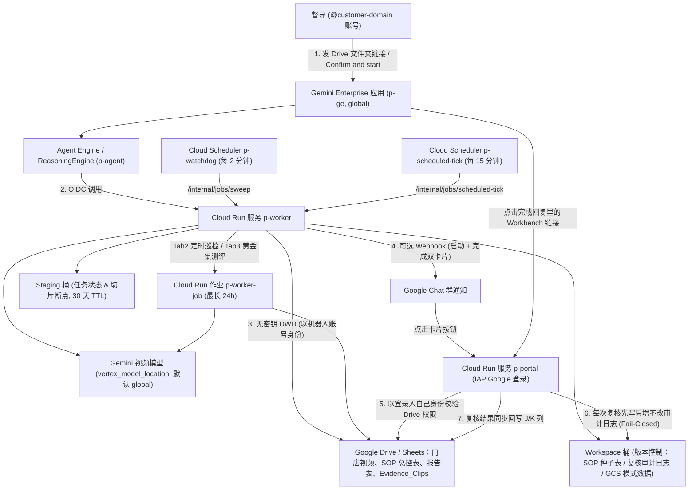

# 门店 CCTV AI 稽核系统（Gemini Enterprise + Gemini 视频理解）

门店督导在 **Gemini Enterprise（下称 GE）** 里把门店监控视频所在的 **Google Drive 文件夹链接**（或 **Google Cloud Storage `gs://` 目录链接**）发给稽核 Agent，系统先做秒级预检（0 Token 消耗），督导回复 `Confirm and start` 后，后台 Cloud Run 自动完成视频去音轨、切片、Gemini 多模态视频分析、跨切片状态接力（如 5–10 分钟消毒浸泡计时与 5 分钟洗手追踪窗口）、去重与 20 秒违规证据裁剪，并根据输入链接类型**自动切换输出方式**：

- **Google Workspace 模式（输入 Google Drive 文件夹）**：在同一个 Drive 文件夹内生成稽核报告 Google Sheet **`📊 AI_Audit_Report_and_Token_Ledger`**（含 `Tab1_Violation_Review` 与 `Tab2_Token_Ledger`）及违规证据子目录 **`📁 Evidence_Clips/`**（每条违规带画面 OSD 时间与 20 秒证据 MP4 链接），SOP 规则从在线总控表 Google Sheet 实时读取。
- **Zero-GWS / 纯 GCS 兜底模式（输入 `gs://...` 或 GCS 控制台链接，无需 Google Workspace）**：在同一个 GCS 目录内直接生成双工作表 Excel 报告 **`📊 AI_Audit_Report_and_Token_Ledger.xlsx`** 及 **`📁 Evidence_Clips/`**，SOP 直接从 Terraform 自动创建的版本控制存储桶（`gs://<PROJECT_ID>-<p>-workspace/sop/master_sheet.xlsx`）读取。两种模式可**同时并存、按单自动路由**，也可独立使用。

> 📖 **完整部署步骤、业务团队操作手册与日常运维排障，请直接阅读 [`docs/DEPLOYMENT_GUIDE.md`](docs/DEPLOYMENT_GUIDE.md)。**

---

## 目录

1. [系统架构与数据流](#1-系统架构与数据流)
2. [跨系统账号体系与安全架构（GCP × GE × Workspace × IAP）](#2-跨系统账号体系与安全架构gcp--ge--workspace--iap)
3. [SOP 与模型版本总控表（6 大页签设计）](#3-sop-与模型版本总控表6-大页签设计)
4. [仓库目录结构](#4-仓库目录结构)
5. [部署与使用快速导航](#5-部署与使用快速导航)
6. [开发者测试与评测 CLI 工具链](#6-开发者测试与评测-cli-工具链)

---

## 1. 系统架构与数据流

### 1.1 组件清单

所有资源名均由 `<env>.tfvars` 中的 `name_prefix`（下文简写为 `<p>`）派生，同一个 GCP 项目内换一个前缀即可独立部署多套环境，互不冲突。

| 组件 | 资源名 | 作用 |
| :--- | :--- | :--- |
| **GE 应用** | `<p>-ge`（`ge_engine_id` 留空时） | 督导的对话入口。由部署流水线自动创建，并将稽核 Agent 挂载进去。位置固定为 `global`。 |
| **GE 稽核 Agent** | 默认显示名 `<品牌> Store CCTV AI Auditor [<p>]` | 对话页内的专属 Agent，内置全量稽核与 `Tab4_Spot_Check` 专项抽检两组快捷指令气泡（Prompt Chips）。 |
| **Agent Engine（ReasoningEngine）** | `<p>-agent` | 负责对话编排：秒级预检、确认启动、查询进度；按用户与会话严格隔离并发任务。运行在 `reasoning_engine_location`。 |
| **Cloud Run 服务（Worker）** | `<p>-worker` | 执行核心稽核：下载视频、去音轨、按 `SEGMENT_DURATION_SEC` 切片、调用 Gemini 视频模型、写报告与证据切片、发送通知。0–20 个实例，每实例 4 vCPU / 16 GiB，单实例并发为 1。 |
| **Cloud Run 作业（Worker Job）** | `<p>-worker-job` | 承载 `Tab2_Scheduled_Jobs` 每日定时巡检与 `Tab3_Golden_Eval` 黄金集回归评测长任务，单次最长支持 24 小时。 |
| **Cloud Run 服务（复核 Dashboard）** | `<p>-portal` | 督导 HTML 复核工作台。前置 **Cloud Run 原生 IAP（Google 登录）**，登录后再按访问者本人的 **Google Drive 权限**逐店鉴权放行。 |
| **Cloud Scheduler 看门狗** | `<p>-watchdog` | 每 2 分钟巡检一次，将容器中断或心跳超时的任务自动从最后一个已完成切片的 Checkpoint 断点续跑。 |
| **Cloud Scheduler 定时刻度** | `<p>-scheduled-tick` | 每 15 分钟轮询一次，读取总控表 `Tab2_Scheduled_Jobs` 定时规则与 `Tab3_Golden_Eval` 评测触发指令，自动派发 Cloud Run 作业。 |
| **Staging 存储桶** | `<PROJECT_ID>-<p>-staging` | 存放任务状态 JSON、切片 Checkpoint、临时去音轨切片。**所有对象 30 天后自动清理**，严禁存放长期业务数据。 |
| **Workspace 存储桶** | `<PROJECT_ID>-<p>-workspace` | **开启对象版本控制（保留最近 30 个历史版本）**，无按时间自动删除规则。存放：初始 SOP 表 `sop/master_sheet.xlsx`、不可篡改的复核审计日志 `audit_logs/reviews/...`、纯 GCS 模式下的门店视频/报告/证据、以及评测切片缓存与历史账本 `eval/rounds/eval_history.jsonl`。 |
| **镜像仓库** | `<p>-images` | Artifact Registry 容器镜像仓库（由 `bootstrap` 创建，开启 `IMMUTABLE_TAGS`）。 |
| **部署服务账号** | `<p>-deployer@<PROJECT_ID>.iam.gserviceaccount.com` | 供 Cloud Build 部署流水线执行 `terraform apply` 与模型/GE 注册（最小权限原则，无项目级 IAM 修改权限）。 |
| **运行时服务账号** | `<p>-worker@<PROJECT_ID>.iam.gserviceaccount.com` | Worker、Job、Agent Engine、Dashboard 共用。通过 **无密钥全网域委派（Keyless DWD）** 模拟 Workspace 机器人账号读写 Drive / Sheets。 |

### 1.2 端到端数据流



1. **发起与秒级预检（0 Token 消耗）**：督导在 GE 中选中稽核 Agent，发送 Google Drive 门店文件夹链接（或 `gs://` 目录）。Agent Engine 秒级完成权限检查、视频数量/时长统计、`<720P` 低清分辨率排查、切片计划计算，并读取当前生效的 SOP 版本与模型名。
2. **后台异步执行与断点续跑**：督导回复 `Confirm and start` 后，Agent Engine 通过 OIDC 触发 `<p>-worker` 后台执行，督导可随时关闭网页。Worker 将每支视频去音轨、切片并交由 Gemini 视频模型逐片分析，每完成一片即向 Staging 桶写入 Checkpoint；若实例重启，`<p>-watchdog` 会在 2 分钟内自动从断点续跑。
3. **同表智能追加与证据归档**：稽核结果直接写回原门店文件夹的 `📊 AI_Audit_Report_and_Token_Ledger`（含 `Tab1_Violation_Review` 与 `Tab2_Token_Ledger`）及 `📁 Evidence_Clips/`（每条违规裁剪 `[T-2s, T+18s]` 共 20 秒 MP4 切片）。同一门店次日上传新视频或重跑 `Tab4_Spot_Check` 专项抽检时，系统自动在原报告表内按视频/规则智能追加或原地更新，**一家门店永远只维护一张报告表**。
4. **Google Chat 双阶段通知**：开启通知后，无论是 GE 单店稽核、`Tab2` 定时批次还是 `Tab3` 黄金集评测，均在**启动瞬间（`🚀 已启动`）**与**完成瞬间（`✅ 已完成`）**向指定 Google Chat 群发送卡片并自动 `@` 对应督导。
5. **IAP 登录 + Drive 逐店鉴权 + 不可篡改审计日志**：督导点击通知卡片或 GE 回复中的复核工作台链接进入 `<p>-portal`，先通过 Google 企业账号登录（IAP），再由系统以**当前登录督导本人身份**实时校验其对该门店报告 Sheet 的 Google Drive 访问权限；每次在页面上点击「确认违规 / 误报 / 待调录像」或修改备注时，系统**先向 Workspace 版本控制桶写入只增不改（`if_generation_match=0`）的 JSON 审计记录，写入成功后才回写 Google Sheet 的 J、K 列**。

### 1.3 稽核报告表 `Tab1_Violation_Review` 列结构

| 列 | 表头 | 说明 |
| :-: | :--- | :--- |
| **A** | `Audit ID` | 单条违规记录唯一 ID |
| **B** | `Video Filename` | 源监控视频文件名 |
| **C** | `Violation Timestamp (MM:SS)` | 视频切片内相对时间（点击 I 列直接播放对应 20s 片段） |
| **D** | `SOP Rule ID` | 触发的 SOP 规则编号（如 `A1`、`A3`、`B2`、`C4`） |
| **E** | `AI Disposition` | AI 判定等级（`CONFIRMED` / `SUSPECTED` / `UNVERIFIED`） |
| **F** | `Severity` | 严重度（`RED_LINE` 红线 / `NORMAL` 一般偏离） |
| **G** | `AI Confidence` | AI 置信度分值 |
| **H** | `Violation Description & Timestamped Trajectory` | 违规事实描述与带画面 OSD 时间戳的完整行为轨迹链 |
| **I** | `Evidence Clip Link (Click to Play)` | 20 秒违规证据 MP4 直链 |
| **J** | `Supervisor Review Status (Dropdown)` | 督导复核状态下拉框：`PENDING`、`✅ CONFIRMED`、`❌ FALSE_POSITIVE`、`⚠️ FOLLOWUP` |
| **K** | `Supervisor Review Note` | 督导复核备注（与复核 Dashboard 双向实时同步） |

> ⚠️ 程序按列号位置读写 J、K 列，请勿在报告表中手动插列、删列或调整列顺序。

---

## 2. 跨系统账号体系与安全架构（GCP × GE × Workspace × IAP）

本方案横跨 **GCP（算力与多模态推理）**、**Gemini Enterprise（对话入口）** 和 **Google Workspace（Drive 视频存取、Sheets 报告与 Google Chat 通知）**。

### 2.1 六类账号/角色职责对照表

| 所属系统 | 账号 / 身份名称 | 类型 | 谁来创建 / 在哪配置 | 核心职责与权限边界 |
| :--- | :--- | :--- | :--- | :--- |
| **GCP** | **1. GCP 项目管理员** | 人工账号 | 客户 IT | 拥有项目的 `roles/owner`；仅在部署时执行状态桶创建、`bootstrap` 初始化与 Cloud Build 触发。 |
| **GCP** | **2. 部署服务账号**<br>`<p>-deployer@<PROJECT_ID>.iam...` | 机器账号 (IAM SA) | `bootstrap` 自动创建 | 供 Cloud Build 流水线使用，负责构建镜像、管理 Cloud Run / GCS / Scheduler / Agent Engine 及注册 GE 应用；**不具备修改项目 IAM 的权限**。 |
| **GCP** | **3. 运行时服务账号**<br>`<p>-worker@<PROJECT_ID>.iam...` | 机器账号 (IAM SA) | `bootstrap` 自动创建 | 挂载在 `<p>-agent`、`<p>-worker`、`<p>-worker-job`、`<p>-portal` 上：<br>• **对内（GCP）**：调用 Vertex AI Gemini 模型、读写 GCS 桶；<br>• **对外（Workspace）**：通过无密钥 DWD（IAM `signJwt`）模拟机器人账号读写 Drive/Sheets，以及在 `<p>-portal` 中模拟当前登录督导校验单店 Drive 权限。 |
| **Workspace** | **4. Workspace 超级管理员** | 人工账号 | 客户 IT | 仅在部署阶段 B 登录 `admin.google.com` 执行一次操作：将 `<p>-worker` 服务账号的数字 `Client ID` 加入「全网域委派（DWD）」白名单。 |
| **Workspace** | **5. Workspace 机器人账号**<br>`cctv-bot@<customer-domain>` | 专用域账号 (含 Drive 配额) | 客户 IT 创建，填入 `workspace_impersonate_user` | **跨云存储桥梁**：因为 GCP IAM 服务账号本身的 Google Drive 存储配额为 0 字节（直接建表或传视频会报 `storageQuotaExceeded`），系统在运行时通过 DWD 模拟该带配额的机器人账号读取 SOP 总控表、下载门店视频、上传 20 秒证据 MP4 并创建报告 Sheet。 |
| **Workspace & GE** | **6. 门店督导 / 业务用户**<br>`auditor@<customer-domain>` | 人工账号 | 业务团队 | 使用同一个 `@<customer-domain>` 企业邮箱：<br>• 在 Google Drive 上传视频（顶层 `cctv-audit` 目录共享给机器人账号一次即可）；<br>• 登录 Gemini Enterprise 发起稽核；<br>• 登录 `<p>-portal` 复核 Dashboard 查看自己有 Drive 权限的门店并提交复核结论。 |

### 2.2 督导复核工作台（`<p>-portal`）双重鉴权与审计日志机制

1. **第一重门禁（Cloud Run 原生 IAP 身份认证）**：
   - 复核工作台运行在独立的 Cloud Run 服务 `<p>-portal` 上，前置 Cloud Run Direct IAP，并在应用层使用 Google 官方公钥强校验 `X-Goog-IAP-JWT-Assertion` 签名与 Audience。
   - 仅 `<env>.tfvars` 中 `portal_allowed_members`（如 `["domain:<customer-domain>"]` 或 `["group:supervisors@<customer-domain>"]`）允许的谷歌企业账号可通过登录；公开 Worker 上的 `/portal` 链接会自动 302 跳转至 `<p>-portal`，Worker 上的 `/api/portal/*` 接口直接返回 403。
2. **第二重门禁（按登录督导本人的 Google Drive 权限逐店隔离）**：
   - 通过 IAP 登录后，`<p>-portal` 通过无密钥 DWD **以当前登录督导本人的邮箱身份**调用 Google Drive API 检查其对该门店报告 Sheet（或门店文件夹）的访问权限：
     - **单店工作台**：若该督导在 Drive 中无权打开该门店报告，直接返回 403 拒绝访问；
     - **多店批次工作台**：并发检查批次内所有门店，自动隐藏该督导无权查看的门店（若全部无权则返回 403）。
3. **Fail-Closed 不可篡改复核审计日志（`audit_logs/reviews/`）**：
   - 督导在工作台每一次修改违规状态（如从 `✅ CONFIRMED` 改为 `❌ FALSE_POSITIVE`）或备注时，系统**先**向开启了对象版本控制的 Workspace 桶写入一条只增不改（`if_generation_match=0`）的 JSON 审计记录：
     `gs://<PROJECT_ID>-<p>-workspace/audit_logs/reviews/<YYYY>/<MM>/<DD>/<job_or_batch_id>/<UTC时间戳>_<8位随机ID>.json`
   - 记录包含：`reviewer_email`（IAP 实名认证邮箱）、`ts_utc`、`rule_id`、`video_filename`、`timestamp_in_clip`、`old_status` $\rightarrow$ `new_status`、`old_note` $\rightarrow$ `new_note`、证据视频链接及完整行快照。**如果审计日志写入失败，系统直接拒绝修改 Google Sheet 并返回 HTTP 500（No Audit Log, No Change）。**

---

## 3. SOP 与模型版本总控表（6 大页签设计）

系统支持完全热插拔的 **双层提示词架构（Layer 1 代码防幻觉内核 + Layer 2 在线表格动态 SOP 规则库）**。在部署阶段 B 运行一行 `scripts/init_sop_sheet.py` 命令即可在客户的 `📁 cctv-audit/SOP/` 目录下自动创建并初始化含完整格式与下拉校验的 6 页签总控表 **`CHAGEE_SOP_and_Model_Control_Tower`**：

| 页签名称 | 用途说明 |
| :--- | :--- |
| **`Tab0_Version_Control`** | **全局版本与模型热切换开关（0.1 秒生效，免重部署）**：<br>• `Active_Prompt_Version`：当前生产生效的 SOP 规则页签名（默认 `Prompt_v1.0_Standard`）；<br>• `Active_Model_Version`：当前生产使用的 Gemini 模型版本（默认 `gemini-3.8-flash`）；<br>• `Fallback_Model_Version`：主模型探测不可用时的兜底模型版本。 |
| **`Prompt_v1.0_Standard`** | **生产标准版 24 条 SOP 规则库**（`A1`–`A5` 洗手与手部卫生、`B0`–`B5` 制冰机周清与冰铲规范、`C1`–`C8` 吧台卫生/效期/毛巾/着装、`D1`–`D4` 营运服务与人效）。包含 `rule_id`、`name`、`category`、`severity`、`detection_type`、`requires_full_context`、`check_instruction`、`pass_criteria`、`fail_criteria` 共 9 列。 |
| **`Prompt_v1.1_Standard`** | **预置的新版 SOP 演进草稿页签**（带标准 9 列表头与下拉框校验）。业务团队可在此编写新版全量规则，先在 `Tab3_Golden_Eval` 评测通过后，再将 `Tab0` 的 `Active_Prompt_Version` 切过来即可一键上线。 |
| **`Tab2_Scheduled_Jobs`** | **每日无人值守定时巡检配置表**（`Rule_ID`、`Rule_Name`、`Root_Folder_URL`、`Trigger_Hour_SGT`、`Trigger_Minute_SGT`（新加坡当地时间，无需换算 UTC）、`Lookback_Days`、`Supervisor_Email`、`Enabled`、`Last_Run_Status`）。支持多层目录自动按末级门店文件夹并发拆单、单视频 `<720P` 自动跳过、文件级防重账本与批次合并通知。 |
| **`Tab3_Golden_Eval`** | **零代码黄金集回归评测工作台**。支持在不影响生产开关的情况下，任选某个 `Prompt_*` 页签与某个 Gemini 模型（如对比 `Prompt_V18` / `Prompt_V22` / `Prompt_v1.0_Standard` 或对比 `gemini-3.8-flash` / `gemini-4-argon`），将 `Trigger_Action` 设为 `START_EVAL` 即可在后台运行完整评测，并在 `Results_Folder_URL` 自动生成带 7 张原生图表的 **5-Tab 测评报告 Sheet**（含加权召回率 `Overall Recall`、宽松召回率 `Lenient Recall (Partial=1)`、`CONFIRMED-Only Recall`、同模型跨 SOP 爬坡图及同 SOP 跨模型对比图）。 |
| **`Tab4_Spot_Check`** | **特定 SOP 专项抽检 / 新 SOP 提示词单点调优工作台**。只需将 1–N 条待测规则填入此页签，在 GE 对话框点击第 2 个气泡 `【Spot-Check Tab4_Spot_Check Only】` 发起稽核，系统即开启 **Scope Lock** 仅核查这几条规则，并按 `rule_id` 智能追加/更新到门店报告表中，绝不冲掉该店已有的其他全量 SOP 记录。 |

---

## 4. 仓库目录结构

| 路径 | 说明 |
| :--- | :--- |
| [`docs/DEPLOYMENT_GUIDE.md`](docs/DEPLOYMENT_GUIDE.md) | **【核心文档】客户环境部署与运维完整手册**（含部署前准备清单、GE License 预检、阶段 A/B 部署步骤、业务使用手册、日常维护与故障排查） |
| `bootstrap/` | 一次性初始化 Terraform（项目 Owner 执行）：创建 `<p>-deployer` 与 `<p>-worker` 服务账号、Artifact Registry 镜像仓库、开启基础 API 并初始化 Discovery Engine 服务代理权限 |
| `main.tf` / `example.tfvars` | 主体基础设施 Terraform：Staging/Workspace 双存储桶、`<p>-worker` 服务与 `<p>-worker-job` 作业、`<p>-portal` IAP 复核工作台、Cloud Scheduler 看门狗与定时刻度、Agent Engine 与 GE 应用注册 |
| `cloudbuild.yaml` + `deploy/` | 自动化部署流水线：构建容器镜像 $\rightarrow$ `terraform plan/apply` $\rightarrow$ GE 登录方式与 License 预检（`check-ge-prereqs`）$\rightarrow$ 部署 ReasoningEngine 并绑定 GE Agent |
| `cctv_audit/` | 核心服务代码（含 `agentic_auditor.py` 多模态切片稽核、`prompt_manager.py` 双层提示词与总控表引擎、`scheduled_auditor.py` 定时巡检与评测调度、`portal.py` / `portal_auth.py` / `review_audit_log.py` IAP 复核工作台与不可篡改审计日志、`gcs_gateway.py` 双模存储网关） |
| `sop/` + `scripts/init_sop_sheet.py` | SOP 总控表快照（`master_sheet.json`、`master_sheet.xlsx`）及一键 DWD 校验 / 自动建表 / 写入 `.tfvars` CLI 工具 |
| `eval/` | 黄金集回归评测引擎（`score_run.py` 双时间窗与双层召回率裁判、`sheet_report.py` 5-Tab 原生图表报告生成器、`run_gcp_round.py` 分布式评测运行器） |
| `tests/`、`eval/tests/` | 单元测试套件（`tests/` 与 `eval/tests/` 100% 离线可运行） |

---

## 5. 部署与使用快速导航

完整的分步操作命令、参数解释与验收标准均维护在 **[`docs/DEPLOYMENT_GUIDE.md`](docs/DEPLOYMENT_GUIDE.md)** 中（单一事实源，避免多处文档不一致）：

1. **[部署前客户准备清单与一键预检 (`docs/DEPLOYMENT_GUIDE.md §2`)](docs/DEPLOYMENT_GUIDE.md#2-部署前客户需要准备的东西)**
   - 组织策略只读检查（`2.2`）
   - 基础 API 启用（`2.3`）
   - GE 登录方式与 License 席位一键预检 `check-ge-prereqs`（`2.4`）
   - Google Drive 业务总目录树 `📁 cctv-audit/{SOP, evaluation, Video}` 规划与一次共享（`2.5`）
2. **[分阶段部署步骤 (`docs/DEPLOYMENT_GUIDE.md §3`)](docs/DEPLOYMENT_GUIDE.md#3-部署步骤)**
   - **阶段 A：GCP 基础设施部署**（建状态桶 $\rightarrow$ `bootstrap` $\rightarrow$ 填 `<env>.tfvars` $\rightarrow$ Cloud Build 预览与部署 $\rightarrow$ 基础设施冒烟验证）
   - **阶段 B：Google Workspace 集成**（配置 DWD 域委派 $\rightarrow$ `init_sop_sheet.py --check-dwd` 验证 $\rightarrow$ 一键在 `cctv-audit/SOP/` 下生成总控表并写回 `<env>.tfvars` $\rightarrow$ 托管 Google Chat Webhook $\rightarrow$ Cloud Build 生效）
   - **纯 GCS（无 Google Workspace）模式说明**
3. **[业务团队使用手册 (`docs/DEPLOYMENT_GUIDE.md §4`)](docs/DEPLOYMENT_GUIDE.md#4-业务团队使用手册)**
   - 4.1 在 GE 里手动发起单店全量稽核
   - 4.2 每日定时巡检（`Tab2_Scheduled_Jobs`）
   - 4.3 特定 SOP 专项抽检（`Tab4_Spot_Check`）
   - 4.4 督导复核 Dashboard（`<p>-portal`）使用说明
   - 4.5 黄金集测评（`Tab3_Golden_Eval`）与 5-Tab 测评报告解读
   - 4.6 切换模型或 SOP 提示词版本（`Tab0_Version_Control`）
4. **[日常维护、审计日志查询、故障排查与环境销毁 (`docs/DEPLOYMENT_GUIDE.md §5–§6`)](docs/DEPLOYMENT_GUIDE.md#5-日常维护)**

---

## 6. 开发者测试与评测 CLI 工具链

### 6.1 运行单元测试

```bash
# 两个测试目录请分开独立运行
.venv/bin/python -m pytest tests/ -q -p no:cacheprovider
.venv/bin/python -m pytest eval/tests -q -p no:cacheprovider
```

### 6.2 黄金集评测开发者 CLI（`eval/`）

除通过总控表 `Tab3_Golden_Eval` 零代码触发外，工程团队也可通过 CLI 直接调用 `eval/` 工具链：
- **双时间窗与双层召回率评分标尺（`eval/score_run.py`）**：
  - **时间预筛窗口**：瞬时洗手台定点动作（`POINT` 模式）采用 **`±20 秒`** 严格时间窗并统计定位误差 `timestamp_drift_sec`；持续过程、5–10 分钟消毒静置与跨阶段交叉污染因果链（`WINDOW` 模式）采用 **`±60 秒`** 时间窗。
  - **两档召回率口径（Gemini Pro 3 次投票取中位数）**：同时输出 **加权严格召回率 `Overall Recall`**（`Full=1.0`、`Partial=0.5`）与 **业务宽松召回率 `Lenient Recall (Partial=1)`**（只要在时间窗内抓到核心违规行为 `score >= 0.5` 即计为检出 `1.0`）。
- **常用 CLI 命令（均支持 `--help`）**：
  - `python -m eval.run_gcp_round`：在本地或通过 `eval/cloudbuild_round.yaml` 触发评测轮次；
  - `python -m eval.sheet_report`：基于 `eval_history.jsonl` 与 `score.json` 生成或原地刷新 5-Tab Google Sheet 测评报告（自动绘制同模型跨 SOP 版本爬坡图与同 SOP 跨模型对比图）；
  - `python -m eval.run_visibility_probe`：针对单条漏检裁剪前后 60–75 秒短片诊断模型视觉可见性。
