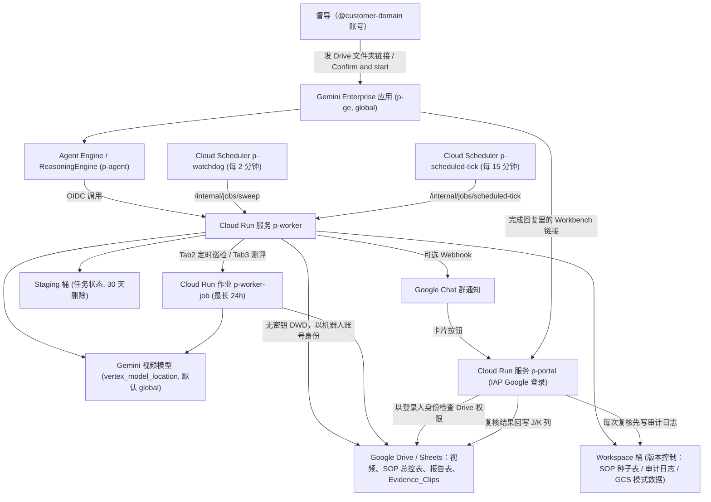

# 门店 CCTV AI 稽核系统：部署与运维手册（客户版）

> 适用代码版本：交付仓库 `cctv-audit-with-GE` 提交 `47dd609` 及之后版本。
> 本手册中所有命令、变量名、输出名、文件名都按代码原样写出。尖括号 `<...>` 都是占位符，要换成你们自己的值，例如 `<PROJECT_ID>`、`<name_prefix>`、`<customer-domain>`。
> 标有 **「待验证」** 的地方，是代码里看不出来、需要部署当天在你们环境里实际确认的。

---

## 目录

1. [系统架构](#1-系统架构)
2. [部署前客户需要准备的东西](#2-部署前客户需要准备的东西)
3. [部署步骤](#3-部署步骤)
4. [业务团队使用手册](#4-业务团队使用手册)
5. [日常维护](#5-日常维护)
6. [附录](#6-附录)

---

## 1. 系统架构

### 1.1 一句话说明

督导在 **Gemini Enterprise（下称 GE）** 里把门店视频所在的 Google Drive 文件夹链接（或 `gs://` 目录）发给稽核 Agent → Agent 先做预检 → 督导回复 `Confirm and start` → 后台 Cloud Run 逐段把视频交给 Gemini 视频模型分析 → 在同一个文件夹里生成报告表和 20 秒证据切片 → Google Chat 通知督导 → 督导在 **复核 Dashboard**（`<name_prefix>-portal`，Google 登录）里看证据、点「确认违规 / 误报 / 待调录像」，每一次操作都会写一条不可修改的审计记录到 GCS。

### 1.2 组件清单

所有资源名都由 `name_prefix`（下文简写 `<p>`）派生，同一个项目里换一个前缀就能再建一套互不影响的环境。

| 组件 | 资源名 | 作用 |
| :--- | :--- | :--- |
| GE 应用 | `<p>-ge`（`ge_engine_id` 留空时） | 督导的对话入口。由部署流水线自动创建，并把稽核 Agent 挂进去。位置固定为 `global`。 |
| GE 里的稽核 Agent | 默认显示名 `<品牌> Store CCTV AI Auditor [<p>]` | 对话页里的 Agent，带 2 组 Prompt chips（见 4.1）。 |
| Agent Engine（ReasoningEngine） | `<p>-agent` | 负责对话：预检、确认、查进度。跑在 `reasoning_engine_location`。 |
| Cloud Run 服务（worker） | `<p>-worker` | 干重活：下载视频、去音轨、切片、调 Gemini、写报告、发通知。0–20 个实例，每实例 4 vCPU / 16 GiB，每个实例同时只跑 1 个任务。 |
| Cloud Run 作业 | `<p>-worker-job` | 定时巡检（Tab2）和黄金集测评（Tab3）用，单次最长 24 小时。 |
| Cloud Run 服务（Dashboard） | `<p>-portal` | 督导复核 Dashboard。前面挂 Cloud Run 原生 IAP（Google 登录），再按 Google Drive 权限逐店放行。 |
| Cloud Scheduler 看门狗 | `<p>-watchdog` | 每 2 分钟一次，把中途崩溃 / 心跳超时的任务从最后一个完成的切片接着跑。 |
| Cloud Scheduler 定时刻度 | `<p>-scheduled-tick` | 每 15 分钟一次，读 Tab2 定时规则和 Tab3 测评触发，派发 Cloud Run 作业。 |
| Staging 桶 | `<PROJECT_ID>-<p>-staging` | 任务状态 JSON、临时切片。**所有对象 30 天后自动删除。** 不能放视频 / 报告 / SOP。 |
| Workspace 桶 | `<PROJECT_ID>-<p>-workspace` | 开了对象版本控制，没有按时间删除（只清理每个文件第 30 个之前的旧版本）。放：初始 SOP 表 `sop/master_sheet.xlsx`、复核审计日志 `audit_logs/reviews/...`、纯 GCS 模式下的视频 / 报告 / 证据、测评缓存与历史。 |
| 镜像仓库 | `<p>-images` | 由 bootstrap 创建，tag 不可改写。 |
| 部署服务账号 | `<p>-deployer@<PROJECT_ID>.iam.gserviceaccount.com` | Cloud Build 流水线用它执行 `terraform apply`。没有任何修改项目 IAM 的权限。 |
| 运行时服务账号 | `<p>-worker@<PROJECT_ID>.iam.gserviceaccount.com` | worker、作业、Agent Engine、Dashboard 共用。通过「无密钥全网域委派（DWD）」以 Workspace 机器人账号身份读写 Drive / Sheets。 |

### 1.3 数据流



文字版：

1. 督导在 GE 里选中稽核 Agent，发 Drive 文件夹链接（或 `gs://` 目录）。
2. Agent Engine 做秒级预检（权限、分辨率、视频数量 / 时长、切片计划、生效规则和模型），**预检不消耗 Token**。
3. 督导回复 `Confirm and start` 后，Agent Engine 用 OIDC 调用 `<p>-worker`，任务在后台跑，督导可以关掉页面。
4. worker 把每个视频去音轨、切片，交给 Gemini 视频模型；每完成一个切片就写一次断点到 Staging 桶。worker 崩了，看门狗每 2 分钟扫一次，从断点续跑。
5. 结果写回原 Drive 文件夹：报告表 `📊 AI_Audit_Report_and_Token_Ledger`（页签 `Tab1_Violation_Review`、`Tab2_Token_Ledger`）和证据子目录 `📁 Evidence_Clips`。纯 GCS 模式写 `📊 AI_Audit_Report_and_Token_Ledger.xlsx`。
6. 开了 Google Chat 通知时，任务开始和完成各推一张卡片，完成卡片上有 `🖥️ Open HTML Supervisor Review Workbench` 按钮；GE 的完成回复里也有 `Open Supervisor Workbench` 链接。
7. 督导点链接 → Google 登录（IAP）→ Dashboard 用**登录人自己的身份**去查他能不能打开这家店的报告表 → 能才放行 → 每次改状态 / 备注先写一条审计日志，写成功才回写报告表 J、K 列。

### 1.4 报告表 Tab1 的列（复核依据）

| 列 | 表头 |
| :-: | :--- |
| A | Audit ID |
| B | Video Filename |
| C | Violation Timestamp (MM:SS) |
| D | SOP Rule ID |
| E | AI Disposition |
| F | Severity |
| G | AI Confidence |
| H | Violation Description & Timestamped Trajectory |
| I | Evidence Clip Link (Click to Play) |
| J | Supervisor Review Status (Dropdown) |
| K | Supervisor Review Note |

J 列下拉值：`PENDING`、`✅ CONFIRMED`、`❌ FALSE_POSITIVE`、`⚠️ FOLLOWUP`。程序按列的位置读 J、K，**不要插列、删列、调列顺序**。

### 1.5 重要提醒（都是代码里写死的行为）

> [!IMPORTANT]
> **数据在哪里处理，请客户先确认合规。**
> - Cloud Run、Cloud Scheduler、两个存储桶、镜像仓库、Cloud Build：在 `region`（例如 `asia-southeast1`）。
> - Gemini 模型调用：在 `vertex_model_location`，默认 `global`（Gemini 3.x 模型在 `global` 提供）。
> - Agent Engine：在 `reasoning_engine_location`（可以和 `region` 不同）。
> - GE 应用：固定在 `global`。
> - 黄金集测评的裁判模型：环境变量 `EVAL_JUDGE_LOCATION`，默认 `global`（Terraform 没有设置它，所以就是 `global`）。
>
> 如果组织策略 `constraints/gcp.resourceLocations` 限制了地区，以上任何一项不在允许范围内都会部署失败。

- **组织策略可能直接挡住部署**：`<p>-worker` 是公网可访问、关闭了调用方 IAM 检查的 Cloud Run 服务（`ingress = "INGRESS_TRAFFIC_ALL"`、`invoker_iam_disabled = true`），因为 GE / Agent Engine / Cloud Scheduler 要调用它（内部接口在代码里校验 OIDC）。如果项目强制了 `constraints/run.managed.requireInvokerIam` 或限制了 `constraints/run.allowedIngress`，这个服务按现设计部署不了，需要给本项目开例外（见 2.2）。
- **Dashboard 需要项目属于一个组织**（`enable_portal_iap = true` 的前提）。
- **费用跟视频小时数成正比**：Gemini 按 Token 计费，Token 量取决于视频时长和画面忙碌程度（agentic 模式模型会自己挑时刻放大），预检**不**预估 Token。真实 Token 和估算金额写在报告 `Tab2_Token_Ledger`。估算单价默认输入 0.75 / 输出 3.75 美元每百万 Token（只影响报表里的估算金额，不影响实际账单）。
- **`terraform destroy` 会删掉 Workspace 桶里的全部内容**（`force_destroy = true`），包括 **复核审计日志 `audit_logs/reviews/`**、SOP 种子表、GCS 模式下的视频和报告。删环境前先备份（见 5.10）。
- **`terraform destroy` 不会删 `<p>-portal`**，需要手动 `gcloud run services delete <p>-portal`（见 5.10）。
- **上线后不要改这几个值**：`project_id`、`reasoning_engine_location`、`ge_engine_id`、`staging_bucket_name`、`name_prefix`。它们是 `terraform_data.stack_teardown` 的触发条件，一改就会触发「整套拆除」钩子：删除 GE 应用 / Agent / 数据存储、Agent Engine、worker 服务、清空 Staging 桶，然后重建（GE 应用会变成新的，督导需要重新进入）。
- **不要重建运行时服务账号**：它的数字 ID 就是 DWD 授权里填的 Client ID，账号一旦重建，DWD 授权会静默失效。
- **`name_prefix` 永远不要复用别的环境用过的**，也不要和同项目里其他环境重复；2–20 个字符，小写字母开头，只含小写字母 / 数字 / `-`，不能以 `-` 结尾。
- **改 `master_prompt_sheet_id` 会让已经发出去的 Dashboard 链接全部失效**：签名密钥由 `GCP_PROJECT`、`STAGING_BUCKET`、`MASTER_PROMPT_SHEET_ID` 派生。所以阶段 B 一定要在正式使用前完成。
- **Staging 桶不能放任何长期文件**（30 天自动删除）：门店视频、报告、SOP 表、黄金集、Chat Webhook 文件都不要放进去，部署和预检会拒绝 SOP / 黄金集指向它。
- **直接在 Google Sheet 里改 J/K 列不会留审计日志**，只有在 Dashboard 里改才会。

---

## 2. 部署前客户需要准备的东西

### 2.1 清单

| # | 事项 | 负责人 | 说明 / 完成标准 |
| :-: | :--- | :--- | :--- |
| 1 | GCP 项目 + 结算账号 | 客户 IT | 新建或已有项目均可，已绑定结算；项目属于你们的组织（Dashboard 需要）。 |
| 2 | 给部署执行人项目 Owner | 客户 IT | 执行人（我方或客户工程师）在该项目有 `roles/owner`。建状态桶、跑 bootstrap、执行 `gcloud builds submit` 都需要。 |
| 3 | 基础 API 预先启用 | 客户 IT / 我方 | 见 2.3。 |
| 4 | 组织策略只读检查 | 客户 IT | 见 2.2，把 4 条命令的输出发给我方。 |
| 5 | 数据驻留确认 | 业务方 + 客户 IT | 确认 1.5 里列的各处理地点可以接受；确认 `region`、`reasoning_engine_location`。 |
| 6 | 模型可用 | 我方 | 生产模型 `gemini-3.8-flash`；部署后在 GE 里跑一次预检确认可用（见 3.13）。 |
| 7 | Workspace 机器人账号 | Workspace 管理员 | 在 `<customer-domain>` 下新建一个普通用户，例如 `cctv-bot@<customer-domain>`，**分配带 Drive 存储空间的付费许可**（报告表和证据切片都存在它名下）。会占 1 个席位。 |
| 8 | Workspace 超级管理员到场 | Workspace 管理员 | 阶段 B 在 `admin.google.com` 做一次全网域委派授权（约 5 分钟）。 |
| 9 | 门店视频 Drive 目录 | 业务方 | 建议「一个门店一个文件夹」，视频直接放在门店文件夹里；定时巡检用一个根目录，下面每店一个子文件夹。把根目录（或每个门店文件夹）**共享给机器人账号，权限「编辑者」**。视频短边至少 720 像素，否则会被跳过。 |
| 10 | GE 许可 | 客户 IT / 业务方 | 给每位要用的督导分配 Gemini Enterprise 许可（席位）。督导账号都是 `@<customer-domain>`。 |
| 10a | **部署项目里已开通 Gemini Enterprise 订阅 / 许可，且执行部署的管理员本人有一个有效 GE 许可** | 客户 IT | 流水线注册 GE Agent 时，Google 会检查调用身份有没有有效的 GE 许可；没有时 GE 应用照样建好，但 **Agent 建不出来**（只打 ⚠️ 警告，部署不报错）。补救办法见 B8。 |
| 11 | Dashboard 准入名单 | 业务方 + 客户 IT | 决定 `portal_allowed_members`：整个域 `domain:<customer-domain>`，或一个 Google 群组 `group:<group>@<customer-domain>`，或逐个 `user:<email>`。**这只决定谁能登录**；能看哪家店还由各人的 Drive 权限决定。 |
| 12 | **Google Chat 通知群与 Incoming Webhook URL** | 业务方 | 提前建好要收稽核启动/完成通知的 Google Chat 群（Space），点击顶部群名称旁下拉菜单 $\rightarrow$ **应用和集成 (Apps & integrations)** $\rightarrow$ **Webhooks** $\rightarrow$ **添加 Webhook (Add webhooks)**，复制生成的 URL（`https://chat.googleapis.com/v1/spaces/.../messages?key=...&token=...`）交给我方。阶段 B 会将该 URL 存入由阶段 A 自动创建的 `gs://<PROJECT_ID>-<p>-workspace/config/google_chat_webhook.txt` 并启用通知（见 B7）。 |
| 13 | 黄金集标注表（可选，测评用） | 业务方 | 黄金集视频目录、人工标注表、测评报告目录，见 4.5。 |
| 14 | 部署机器 | 我方 | 装好 `gcloud`、Terraform ≥ 1.9（`main.tf` 要求 `>= 1.9.0`）、Python 3.12+、`git`。也可以直接用 Cloud Shell。 |

### 2.2 组织策略检查（客户 IT 执行，只读）

```bash
PROJECT_ID=<PROJECT_ID>
gcloud org-policies describe constraints/run.managed.requireInvokerIam --project=$PROJECT_ID --effective
gcloud org-policies describe constraints/run.allowedIngress --project=$PROJECT_ID --effective
gcloud org-policies describe constraints/gcp.resourceLocations --project=$PROJECT_ID --effective
gcloud org-policies describe constraints/iam.allowedPolicyMemberDomains --project=$PROJECT_ID --effective
```

怎么看结果：

| 约束 | 如果是强制 / 有限制 | 处理 |
| :--- | :--- | :--- |
| `run.managed.requireInvokerIam` | `<p>-worker` 无法以「关闭调用方 IAM」方式部署 | 请组织管理员给本项目开例外。 |
| `run.allowedIngress` | 若不允许 `all`，`<p>-worker` 和 `<p>-portal`（两者都是 `INGRESS_TRAFFIC_ALL`）部署不了 | 请组织管理员给本项目开例外。 |
| `gcp.resourceLocations` | 1.5 中任何处理地点不在允许列表里都会失败 | 调整 `region` / `reasoning_engine_location`，或请管理员放行（含 `global`）。 |
| `iam.allowedPolicyMemberDomains` | `portal_allowed_members` 里的域 / 群组 / 用户必须在允许范围内 | 确认 `<customer-domain>` 在允许列表里。 |

> [!WARNING] 待验证
> `iam.allowedPolicyMemberDomains` 强制时，部署过程中给 Google 托管服务代理（Discovery Engine、Agent Engine、IAP 的 `service-<项目号>@gcp-sa-*.iam.gserviceaccount.com`）授权是否会被拦截，代码里看不出来。如果 apply 在这些 IAM 绑定上报 `FAILED_PRECONDITION` / 域限制错误，请管理员把这些服务代理放行。

### 2.3 API：谁启用、要不要预先启用

| API | 由谁启用 |
| :--- | :--- |
| `cloudbuild`、`artifactregistry`、`cloudresourcemanager`、`iam`、`iamcredentials`、`sheets`、`monitoring` | bootstrap（`bootstrap/main.tf`）自动启用 |
| `aiplatform`、`artifactregistry`、`run`、`storage`、`iam`、`iamcredentials`、`drive`、`sheets`、`discoveryengine`、`monitoring`、`cloudscheduler`、`iap`（`enable_portal_iap = true` 时） | 主体部署（`main.tf`）自动启用 |

Terraform 启用 API 本身要靠 Service Usage API，建状态桶要靠 Cloud Storage API。新项目通常默认已开，保险起见先执行一次：

```bash
gcloud services enable serviceusage.googleapis.com cloudresourcemanager.googleapis.com storage.googleapis.com discoveryengine.googleapis.com --project=<PROJECT_ID>
```

> [!IMPORTANT]
> **全新项目还要补两件事**（试部署时都碰到了），具体命令在下文阶段 A 的「A5. 新项目：补齐权限与服务代理」，必须在 bootstrap 之后、第一次跑流水线（A6）之前做：
> 1. 给 Cloud Build 默认服务账号 `<PROJECT_NUMBER>@cloudbuild.gserviceaccount.com` 授予 `roles/logging.logWriter`；
> 2. 手动创建 Discovery Engine 和 Vertex AI 的服务代理（Terraform 要给它们授权，但新项目里它们还不存在）。

### 2.4 部署前 GE 登录方式与 License 一键预检（客户管理员必做）

**为什么要先查这一步？**
客户的 Gemini Enterprise（GE）席位虽然买在公司的 **Billing Account（结算账号）** 上，但**如果是新开的 GCP Project**，默认会有两个卡点：
1. 新 Project 还没选“员工用什么账号登录（Identity Provider）”；
2. 新 Project 默认是 **0 个 GE 席位**（还没从公司账单账号划拨过来），且执行部署的管理员名下在该项目里还没有绑上 GE License。如果不提前设好，后面往 GE 里挂 Agent 时会被拒（报 `active Gemini Enterprise license is not available`）。

**第 1 步：克隆代码并跑一键预检脚本**

```bash
git clone https://github.com/percy-han/cctv-audit-with-GE.git
cd cctv-audit-with-GE
gcloud auth login <管理员邮箱>
gcloud config set project <PROJECT_ID>
gcloud auth application-default login

python3 -m venv .venv-deploy && .venv-deploy/bin/pip install --require-hashes -r deploy/requirements-deploy.txt
.venv-deploy/bin/python deploy/deploy_reasoning_engine.py --project-id <PROJECT_ID> check-ge-prereqs --admin-email <管理员邮箱>
```

**第 2 步：根据预检输出处理（若报 ❌，管理员在网页 1 分钟点完）**

| 检查项 | 报 ❌ 时的原因 | 管理员操作步骤 |
| :--- | :--- | :--- |
| **`[1/3] GE 登录方式（Identity Provider）`** | 新项目第一次打开 GE，尚未选择登录身份源 | **IaC 部署时会自动将其设为 `Use Google Identity` (`GSUITE`)**。如果在预检阶段就想一起清零，可在上面的预检命令末尾加 `--fix-idp`，或在 `https://console.cloud.google.com/gemini-enterprise/settings?project=<PROJECT_ID>` 勾选 **`Use Google Identity`** 保存。 |
| **`[2/3] GE License 席位池与管理员持证`** | 新项目还没从 Billing Account 划拨 GE 席位 | **① 从账单划拨席位到新项目（必做）**：打开 `https://console.cloud.google.com/gemini-enterprise/licenses?project=<PROJECT_ID>` $\rightarrow$ 点击 **Distribute licenses / 分配许可**，从公司 Billing Account 划拨席位到本项目（区域选 `global`），建议同时勾选 **Auto-assign licenses on sign-in（首次登录自动分配）**。<br>**② 给部署管理员自己绑 1 个席位**：打开 `https://console.cloud.google.com/gemini-enterprise/user-license?project=<PROJECT_ID>` $\rightarrow$ 点击 **Add users / 添加用户**，填入当前管理员自己的邮箱并保存，确认状态为 `Assigned`。 |
| **`[3/3] 项目内已有 GE 应用`** | 提示当前项目是否已有现成 GE 应用 | 如果客户是在**已有 GE 的老项目**里部署，这里会列出他们现成的 GE 应用 ID；把该 ID 填进 `<env>.tfvars` 的 `extra_ge_engine_ids = ["<已有应用ID>"]`，Agent 就会直接挂进他们平时用的 GE 里，员工不用换新网址。 |

**第 3 步：重跑一次 `check-ge-prereqs`（可加 `--fix-idp`）**，确认输出 `🎉 预检全部通过！` 后，再进入第 3 节开始正式部署。只要部署前项目中已有激活的 GE License，**Cloud Build 流水线（`<p>-deployer` 服务账号）会在部署过程中全自动完成 `Use Google Identity` 设置和 GE Agent + 快捷指令气泡（Prompt Chips）挂载**，无需人工再去网页或命令行手动挂载。

---

## 3. 部署步骤

整体分两段：

- **阶段 A：GCP 基础设施**（不依赖 Workspace）：状态桶 → bootstrap → 填配置 → 预览 → 部署 → 验证。做完后系统已经可以用纯 GCS 目录跑通一遍。
- **阶段 B：Google Workspace 集成**：机器人账号 → DWD 授权 → SOP 总控表 → 共享目录 → 把总控表 ID 填回配置并重新部署 → GE / Dashboard 验收。

下文 `<env>` 表示这套环境的配置文件名（任意，例如 `prod`，**不能叫 `example`**），`<p>` 表示 `name_prefix`。所有命令都在**仓库根目录**（`main.tf` 所在目录）执行，除非写明 `cd bootstrap`。

```bash
git clone https://github.com/percy-han/cctv-audit-with-GE.git
cd cctv-audit-with-GE
gcloud auth login
gcloud config set project <PROJECT_ID>
```

---

### 阶段 A：GCP 基础设施

#### A1. 创建 Terraform 状态桶（每个项目一次，Owner 执行）

```bash
bootstrap/create_state_bucket.sh <PROJECT_ID> <region>
# 桶名默认 <PROJECT_ID>-tfstate；脚本可重复执行，已存在会提示 exists，并开启版本控制
```

#### A2. 复制四个配置文件

```bash
cp example.tfvars <env>.tfvars
cp example.gcs.tfbackend <env>.gcs.tfbackend
cp bootstrap/example.tfvars bootstrap/<env>.tfvars
cp bootstrap/example.gcs.tfbackend bootstrap/<env>.gcs.tfbackend
```

两个 `.gcs.tfbackend` 的内容：

```hcl
# <env>.gcs.tfbackend（仓库根目录）
bucket = "<PROJECT_ID>-tfstate"
prefix = "<p>/main"

# bootstrap/<env>.gcs.tfbackend
bucket = "<PROJECT_ID>-tfstate"
prefix = "<p>/bootstrap"
```

`bootstrap/<env>.tfvars`：

```hcl
project_id  = "<PROJECT_ID>"
name_prefix = "<p>"            # 2-20 字符，全新、从未用过
region      = "<region>"       # 例如 asia-southeast1
trigger_env = "<env>"          # 必须等于根目录配置文件名 <env>
trigger_repository = ""        # 不用推送即部署时留空
```

> 两边的 `project_id`、`name_prefix`、`region` **必须完全一致**。

#### A3. 运行 bootstrap（项目 Owner 执行一次）

```bash
cd bootstrap
terraform init -backend-config=<env>.gcs.tfbackend
terraform apply -var-file=<env>.tfvars
terraform output manual_deploy_command
cd ..
```

bootstrap 会创建：

- 部署服务账号 `<p>-deployer`，授予以下项目角色：`roles/serviceusage.serviceUsageAdmin`、`roles/browser`、`roles/storage.admin`、`roles/run.admin`、`roles/iap.admin`、`roles/cloudscheduler.admin`、`roles/aiplatform.user`、`roles/discoveryengine.admin`、`roles/logging.logWriter`；在 `<p>-worker` 这一个账号上的 `roles/iam.serviceAccountUser`；在镜像仓库上的 `roles/artifactregistry.admin`。
- 运行时服务账号 `<p>-worker`，授予项目级 `roles/aiplatform.user`，以及对自己的 `roles/iam.serviceAccountTokenCreator`（无密钥 DWD 签名用）。
- 镜像仓库 `<p>-images`（tag 不可改写）。

输出：`deployer_service_account`、`worker_service_account`、`image_repository`、`deploy_trigger`、`manual_deploy_command`。

> [!TIP]
> bootstrap 做完，`<p>-worker` 账号就已经存在，**阶段 B 的 B1、B2（机器人账号、DWD 授权）可以从这里开始和阶段 A 并行做**。Client ID 可以这样查：
> ```bash
> gcloud iam service-accounts describe <p>-worker@<PROJECT_ID>.iam.gserviceaccount.com --format='value(uniqueId)'
> ```

#### A4. 填写主体配置 `<env>.tfvars`

阶段 A 推荐的写法（阶段 B 再补 `master_prompt_sheet_id`）：

```hcl
project_id                = "<PROJECT_ID>"
name_prefix               = "<p>"
region                    = "<region>"                 # 例如 asia-southeast1
reasoning_engine_location = "<agent-engine-region>"    # Agent Engine 所在区域

# 阶段 A 先留空：Drive 和 gs:// 任务都会用 Terraform 自动放进
# gs://<PROJECT_ID>-<p>-workspace/sop/master_sheet.xlsx 的初始规则表。阶段 B 再改成 Google Sheet ID。
master_prompt_sheet_id     = ""
# 机器人账号建好后填；还没建可以先填 ""，阶段 B 再填并重新部署
workspace_impersonate_user = "cctv-bot@<customer-domain>"

# 全新 GE 应用（不复用旧应用）
ge_engine_id        = ""     # "" = 自动创建 <p>-ge
extra_ge_engine_ids = []

ge_company_name = "<Company>"   # 新 GE 应用显示的公司名，可留空
ge_tenant_label = "<brand>"     # Agent 描述和默认显示名里的品牌，可留空

# 复核 Dashboard（默认开启；开启时准入名单必填）
enable_portal_iap      = true
portal_allowed_members = ["domain:<customer-domain>"]   # 或 "group:<group>@<customer-domain>" / "user:<email>"

# Google Chat 通知（可选，见 B7）
enable_google_chat_notification = false
```

每个变量的含义、默认值见 [附录 6.1](#61-变量参考tfvars)。注意：

- `container_image` **不要写进 tfvars**，流水线会自动传入本次构建的镜像 digest。
- `reasoning_engine_location`：请确认所选区域提供 Agent Engine。
- `master_prompt_sheet_id = ""`：需要使用**包含「空值修复」的版本**。旧版本在这个值为空时，创建 Agent Engine 会报 `reasoning_engine.spec.deployment_spec.env[3].value; Message: Required field is not set.`（见 5.11）。如果手上是旧版本，阶段 A 临时填 Workspace 桶里的种子表即可（就是部署后 `terraform output gcs_sop_uri` 的值，可以提前按命名规则写出）：
  ```hcl
  master_prompt_sheet_id = "gs://<PROJECT_ID>-<p>-workspace/sop/master_sheet.xlsx"
  ```

> [!WARNING] 待验证
> `asia-southeast1` 是否提供 Vertex AI Agent Engine，代码里没有写；`example.tfvars` 的注释举的例子是 `us-central1`。部署前请在控制台确认，或接受 Agent Engine 放在另一个区域（对话内容会在该区域处理）。

这些配置文件**不含密钥**。用手动部署时它们只要在当前目录里即可（`.gitignore` 故意没有忽略它们，`gcloud builds submit` 会一起上传）；用推送即部署时要提交到 Git。

#### A5. 新项目：确认服务代理与权限生效，然后等 1–2 分钟

`bootstrap/main.tf` 已经自动完成了以下三件事（无需手工敲命令，但如果是旧版 `bootstrap` 可以用下面命令手工补齐）：

1. **自动为 Cloud Build 默认服务账号授予日志权限**（`${PROJECT_NUMBER}@cloudbuild.gserviceaccount.com` -> `roles/logging.logWriter`）。
2. **自动创建 Discovery Engine 与 Vertex AI 两个 Google 托管服务代理**（`service-${PROJECT_NUMBER}@gcp-sa-discoveryengine.iam.gserviceaccount.com` 和 `service-${PROJECT_NUMBER}@gcp-sa-aiplatform-re.iam.gserviceaccount.com`）。
3. **自动为 Discovery Engine 服务代理授予 `roles/discoveryengine.serviceAgent` 项目级角色**：
   > [!IMPORTANT]
   > 在全新 GCP 项目里，仅调用 `gcloud beta services identity create --service=discoveryengine.googleapis.com` **只会创建出服务账号本身，不会自动绑定 `roles/discoveryengine.serviceAgent` 角色**！如果少了这个绑定，用户在 Gemini Enterprise 对话框里调用 Agent 时会报 `400 PERMISSION_DENIED: Permission 'aiplatform.reasoningEngines.query' denied on resource ...`。新版 `bootstrap/main.tf` 已通过 `google_project_iam_member.discoveryengine_service_agent` 自动绑定该角色。

如果是旧版 `bootstrap` 或手工核查，可执行：

```bash
PROJECT_NUMBER=$(gcloud projects describe <PROJECT_ID> --format='value(projectNumber)')
gcloud services enable discoveryengine.googleapis.com aiplatform.googleapis.com --project=<PROJECT_ID>
gcloud beta services identity create --service=discoveryengine.googleapis.com --project=<PROJECT_ID>
gcloud beta services identity create --service=aiplatform.googleapis.com --project=<PROJECT_ID>
gcloud projects add-iam-policy-binding <PROJECT_ID> \
  --member="serviceAccount:service-${PROJECT_NUMBER}@gcp-sa-discoveryengine.iam.gserviceaccount.com" \
  --role="roles/discoveryengine.serviceAgent"
gcloud projects add-iam-policy-binding <PROJECT_ID> \
  --member="serviceAccount:${PROJECT_NUMBER}@cloudbuild.gserviceaccount.com" \
  --role="roles/logging.logWriter"
```

**等 1–2 分钟**：bootstrap 刚授予的 IAM 权限需要时间生效。立刻跑流水线可能报 403 `storage.objects.get`，等一两分钟重试即可。

#### A6. 预览（不改任何东西）

把 A3 输出的 `manual_deploy_command` 拿来，在 `--substitutions=` 的值末尾加上 `,_APPLY=false`：

```bash
gcloud builds submit --project=<PROJECT_ID> --region=<region> --config=cloudbuild.yaml \
  --gcs-source-staging-dir=gs://<PROJECT_ID>-tfstate/source \
  --service-account=projects/<PROJECT_ID>/serviceAccounts/<p>-deployer@<PROJECT_ID>.iam.gserviceaccount.com \
  --substitutions=_ENV=<env>,_REGION=<region>,_REPO=<p>-images,_IMAGE=cctv-audit-worker,_DEPLOYER_SA_ID=<p>-deployer,_APPLY=false
```

流水线三步：`resolve-image`（这份源码对应的镜像是否已存在）→ `build-image`（不存在就构建并推送）→ `terraform`（读回镜像 digest → `terraform init` → `terraform plan`）。`_APPLY=false` 时只到 plan 为止，日志最后打印 `APPLY=false: plan only, nothing was changed.`。

**怎么读 plan**（在 Cloud Build 日志的 `terraform` 步骤里找 `Plan: X to add, Y to change, Z to destroy`）：

| 场景 | 正常的样子 | 出现就停下来、先找我方 |
| :--- | :--- | :--- |
| 第一次部署 | 全部是 `to add`，`0 to destroy` | 任何 destroy |
| 升级 / 改配置 | `terraform_data.vertex_reasoning_engine` **must be replaced**（换镜像或改 SOP 表 / 机器人账号时，Agent Engine 会就地更新）；`terraform_data.portal_service[0]` **must be replaced**（重新部署 Dashboard）；`google_cloud_run_v2_service.cctv_audit_worker[0]`、`google_cloud_run_v2_job.cctv_audit_job_worker[0]` **updated in-place** | `terraform_data.stack_teardown` 被 replace / destroy（会触发整套拆除）；任何 `google_storage_bucket.*` 被 destroy / replace；`google_cloud_scheduler_job.*`、IAM 成员被 destroy；其他任何你看不懂的 destroy |

> 上面「正常」里两个 `terraform_data` 的 replace 没有销毁动作（它们没有销毁钩子），只是重新执行部署脚本。

#### A7. 正式部署

去掉 `,_APPLY=false`，执行 A3 输出的原命令：

```bash
gcloud builds submit --project=<PROJECT_ID> --region=<region> --config=cloudbuild.yaml \
  --gcs-source-staging-dir=gs://<PROJECT_ID>-tfstate/source \
  --service-account=projects/<PROJECT_ID>/serviceAccounts/<p>-deployer@<PROJECT_ID>.iam.gserviceaccount.com \
  --substitutions=_ENV=<env>,_REGION=<region>,_REPO=<p>-images,_IMAGE=cctv-audit-worker,_DEPLOYER_SA_ID=<p>-deployer
```

- 构建超时 1 小时；Agent Engine 创建 / 更新最慢，一次可能 5–15 分钟。

> [!NOTE]
> **参考耗时**：试部署（全新项目）里阶段 A 从建项目到部署完成、冒烟检查通过，端到端约 **24 分钟**，其中包含几次因 A5 那两个问题导致的构建重试。按本手册提前做完 A5，一般会更快。
- apply 之后流水线会再跑一次 plan，**必须为空**才算成功：日志出现 `CONVERGED: post-apply plan is empty.`，随后打印全部 `terraform output`。若出现 `NOT CONVERGED`，构建失败，请把日志发给我方。
- 部署会自动完成：启用 API、建两个桶、把 `sop/master_sheet.xlsx` 种子表放进 Workspace 桶（只在不存在时写一次，之后绝不覆盖）、部署 `<p>-worker` / `<p>-worker-job` / 两个 Cloud Scheduler、部署 `<p>-portal` 并开启 IAP、创建 Agent Engine、创建 GE 应用并注册 Agent 和 Prompt chips。

#### A8. 查看输出

输出在 Cloud Build 日志末尾。之后想在本地再看：

```bash
terraform init -backend-config=<env>.gcs.tfbackend
terraform output
terraform output portal_url
terraform output workspace_dwd_client_id
terraform output workspace_dwd_scopes
terraform output workspace_identity
terraform output gcs_sop_uri
terraform output gemini_enterprise_console_url
```

| 输出名 | 用途 |
| :--- | :--- |
| `portal_url` | Dashboard 地址 `https://<p>-portal-<项目号>.<region>.run.app` |
| `cloud_run_worker_pool_url` | worker 地址 |
| `workspace_dwd_client_id` | DWD 授权要填的 Client ID |
| `workspace_dwd_scopes` | DWD 授权要填的 OAuth 范围（逗号分隔，原样粘贴） |
| `workspace_identity` | 要被共享文件夹的账号（填了机器人就是机器人邮箱） |
| `worker_service_account_email` | 运行时服务账号 |
| `staging_bucket_name` / `workspace_bucket_name` | 两个桶名 |
| `gcs_sop_uri` | Workspace 桶里的种子 SOP 表 |
| `gemini_enterprise_engine_id` | GE 应用 ID（`<p>-ge`） |
| `gemini_enterprise_console_url` | 控制台里打开 GE 应用和 Agent 的地址 |
| `container_image` / `artifact_registry_repo` | 当前部署的镜像 digest / 仓库 |
| `eval_results_folder_id` / `eval_golden_uri` / `eval_golden_sheet_id` / `eval_report_time_zone` | 命令行测评用 |

#### A9. 阶段 A 验收（不依赖 Workspace）

1. 资源都在：
   ```bash
   gcloud run services list --project=<PROJECT_ID> --region=<region>          # 应有 <p>-worker、<p>-portal
   gcloud run jobs list --project=<PROJECT_ID> --region=<region>              # 应有 <p>-worker-job
   gcloud scheduler jobs list --project=<PROJECT_ID> --location=<region>      # 应有 <p>-watchdog、<p>-scheduled-tick
   gcloud storage ls gs://<PROJECT_ID>-<p>-workspace/sop/                      # 应有 master_sheet.xlsx
   ```
2. Dashboard 的 IAP 生效：浏览器打开 `<portal_url>/portal`，应立即跳到 Google 登录页（HTTP 302 重定向到 `accounts.google.com`）。命令行检查：
   ```bash
   curl -s -I "$(terraform output -raw portal_url)/portal"
   # 期望：HTTP/2 302，Location: https://accounts.google.com/...，并带 x-goog-iap-generated-response: true
   ```
   用准入名单外的账号登录会看到 IAP 的无权限页。不带签名参数登录后看到报错页是正常的（真正的 Dashboard 链接由任务通知 / GE 回复生成）。**不要用 `/healthz` 或根路径做检查**：试部署实测在 `run.app` 地址上 `/healthz` 返回 404，根路径也返回 404。
3. 用纯 GCS 目录跑一单（可选但推荐，证明模型和流水线都通）：
   ```bash
   gcloud storage cp <本地测试视频.mp4> gs://<PROJECT_ID>-<p>-workspace/stores/test-store/
   ```
   然后按 3.13 在 GE 里发 `gs://<PROJECT_ID>-<p>-workspace/stores/test-store/`，跑完在同一目录看到 `📊 AI_Audit_Report_and_Token_Ledger.xlsx` 和 `📁 Evidence_Clips/`。

---

### 阶段 B：Google Workspace 集成

#### B1. 建机器人账号（Workspace 管理员）

在 `admin.google.com` 新建用户，例如 `cctv-bot@<customer-domain>`，分配带 Drive 存储空间的付费许可。原因：服务账号自己的 Drive 配额是 0，直接用它建报告表 / 传证据视频会报 `storageQuotaExceeded`；所以运行时服务账号要「化身」这个机器人账号去读写。

#### B2. 全网域委派授权（Workspace 超级管理员，一次）

1. **自动打印的 Client ID 和 OAuth 范围**：
   在阶段 A 执行 `bootstrap`（A3）和正式部署（A7/A8）结束时，Terraform 都会**自动打印** `workspace_dwd_client_id` 和 `workspace_dwd_scopes`。随时也可以用命令查看：
   ```bash
   terraform output workspace_dwd_client_id
   terraform output workspace_dwd_scopes
   # 或者直接查服务账号 uniqueId：
   gcloud iam service-accounts describe <p>-worker@<PROJECT_ID>.iam.gserviceaccount.com --format='value(uniqueId)'
   ```
2. `admin.google.com` → 安全（Security）→ 访问权限和数据控制（Access and data control）→ API 控制（API controls）→ 管理全网域委派（Manage Domain Wide Delegation）→ 添加（Add new）：
   - **客户端 ID（Client ID）**：粘贴上面打印出来的 21 位数字 `workspace_dwd_client_id`
   - **OAuth 范围（OAuth Scopes）**：原样粘贴 `workspace_dwd_scopes` 的值：
     ```text
     https://www.googleapis.com/auth/drive,https://www.googleapis.com/auth/spreadsheets,https://www.googleapis.com/auth/userinfo.profile
     ```
   - `drive`、`spreadsheets` 是必须的；`userinfo.profile` 只用于 Google Chat 通知里 `@` 发起人（没授权也不影响稽核，只是通知里显示纯邮箱）。
3. **怎么验证 DWD 有没有生效（一行命令预检）**：
   添加完成后，直接执行下面的预检命令验证服务账号能否以机器人身份拿到 Drive/Sheets 令牌并检查云端硬盘配额：
   ```bash
   python3 -m venv .venv && .venv/bin/pip install -r requirements.txt
   .venv/bin/python scripts/init_sop_sheet.py --tfvars <env>.tfvars --check-dwd
   ```
   - **生效时**：打印 `✅ DWD PASSED: <p>-worker@<PROJECT_ID>.iam.gserviceaccount.com (Client ID: ...) -> cctv-bot@<customer-domain> (Drive quota: ... MB used / ... GB limit)`。
   - **未生效或配置有误时**：直接指出具体原因（如 `unauthorized_client` 表示 DWD 还没生效或 Scope 漏填、`invalid_grant` 表示机器人账号不存在或未分许可），并给出修复命令，返回非 0 退出码。

> [!NOTE]
> Dashboard 的 Drive 权限检查也是靠这条 DWD 授权「以登录人自己的身份」查 Drive，所以**登录 Dashboard 的人必须是机器人账号同一个 Workspace 域里的用户**。

#### B3. 自动创建并初始化 SOP 总控表（Google Sheet）并写回 `<env>.tfvars`

只要 B2 的 `--check-dwd` 验证通过，**无需在浏览器里手工建表或导文件**，直接用一条命令让脚本通过 DWD 在机器人账号的 Google Drive 里自动新建 `CHAGEE_SOP_and_Model_Control_Tower` 总控表、写入全部 7 个标准页签与下拉菜单校验、共享给管理员或业务域，并自动把生成的 Sheet ID 写回 `<env>.tfvars`：

```bash
.venv/bin/python scripts/init_sop_sheet.py \
  --tfvars <env>.tfvars \
  --check-dwd \
  --create-sheet \
  --share-with domain:<customer-domain> \
  --update-tfvars
```

- `--create-sheet`：若 `<env>.tfvars` 里的 `master_prompt_sheet_id` 为空或还是阶段 A 的 `gs://...` 种子路径，脚本会自动在机器人 Drive 下创建一张新 Google Sheet 并写入全部 6 个页签；若 `<env>.tfvars` 里已经填了某张 Google Sheet ID，则就地更新并校验该表。
- `--share-with`：可传 `user:<邮箱>`、`group:<群组邮箱>` 或 `domain:<域名>`（可重复传多个），自动授予编辑者（Writer）权限，方便督导和管理员直接在浏览器打开编辑。
- `--update-tfvars`：自动把新建的 Google Sheet ID 写回 `<env>.tfvars` 的 `master_prompt_sheet_id = "<SheetID>"`。

> **备选方式（已有现成 Google Sheet 或浏览器手工导入）**：
> - 如果客户已经有建好的空白 Google Sheet（已共享给机器人账号为编辑者），传 `--sheet-id <SheetID> --tfvars <env>.tfvars --overwrite --update-tfvars` 即可写入并更新配置。
> - 如果想纯浏览器操作：新建空白 Google Sheet → 文件（File）→ 导入（Import）→ 上传 `sop/master_sheet.xlsx` → 选「替换电子表格（Replace spreadsheet）」，共享给机器人账号后把 Sheet ID 手工填入 `<env>.tfvars` 的 `master_prompt_sheet_id`。

总控表的页签（来自 `sop/master_sheet.json`）：

| 页签 | 用途 |
| :--- | :--- |
| `Tab0_Version_Control` | 版本开关：`Active_Prompt_Version`（生效的规则页签名，默认 `Prompt_v1.0_Standard`）、`Active_Model_Version`、`Fallback_Model_Version`，D 列 `Candidates` 是候选列表 |
| `Prompt_v1.0_Standard` | 当前生产 SOP 规则（每行一条，9 列：`rule_id`、`name`、`category`、`severity`、`detection_type`、`requires_full_context`、`check_instruction`、`pass_criteria`、`fail_criteria`） |
| `Prompt_v1.1_Standard` | 空白候选规则占位页签（仅含 9 列表头），供业务后续迭代新版本 SOP 或在 `Tab3_Golden_Eval` 做对比测评时粘贴使用 |
| `Tab2_Scheduled_Jobs` | 定时巡检规则（见 4.2） |
| `Tab3_Golden_Eval` | 黄金集测评触发（见 4.5） |
| `Tab4_Spot_Check` | 专项抽检 / 新 SOP 测试（见 4.3） |

> 程序也认旧的中文页签名（如 `Tab0_版本总控与回滚开关`、`Tab2_定时巡检配置表`），但新建请用上表的英文名，**不要改页签名和表头**。

#### B4. 共享门店视频目录

| 共享什么 | 给谁 | 权限 |
| :--- | :--- | :--- |
| SOP 总控表 | 机器人账号 / 督导团队 | 用 B3 的 `--create-sheet --share-with` 创建时，机器人账号天然是所有者（Owner），且已自动共享给指定用户/域；若是手工建表，请共享给机器人账号为**编辑者** |
| 门店视频根目录 / 各门店文件夹 | 机器人账号 | **编辑者**（报告表和证据切片要写回这个文件夹） |
| 门店文件夹 / 报告表 | 每位要复核这家店的督导 | 至少查看者（决定他在 Dashboard 里能看哪家店） |
| 测评用的黄金集视频目录 / 标注表 / 报告目录 | 机器人账号 | 见 4.5 |

> [!WARNING] 待验证
> 视频放在**共享云端硬盘（Shared Drive）**还是普通「我的云端硬盘」共享文件夹，代码都支持（调用带 `supportsAllDrives`），但客户实际目录形态请在部署当天用一个真实门店文件夹跑一次预检确认。

#### B5. 执行 IaC 流水线完成绑定与部署

B3 的 `--update-tfvars` 已经自动把 `<env>.tfvars` 里的 `master_prompt_sheet_id` 和 `workspace_impersonate_user` 更新好了（确认无误即可）：

```hcl
master_prompt_sheet_id     = "<SheetID>"                     # B3 自动写入的 Google Sheet ID
workspace_impersonate_user = "cctv-bot@<customer-domain>"
```

`master_prompt_sheet_id` 在 `terraform plan` 阶段就会校验格式：误贴了 Drive **文件夹**链接会直接报错。

#### B5. 配置 Google Chat 通知（推荐在跑阶段 B 部署流水线前一起配好）

如果客户已经在准备阶段（§2.1 第 12 项）提供了 Google Chat 群的 Incoming Webhook URL，可以在跑阶段 B 的 IaC 流水线前一起配进 `<env>.tfvars`，这样一次部署就能同时生效 SOP 总控表和 Chat 通知（详见 **B7**）。

然后直接跑 **先预览（A6）再正式部署（A7）** 的两条 IaC 流水线命令，把总控表、机器人账号和 Chat 通知配置注入 `<p>-worker`、`<p>-worker-job`、`<p>-portal` 和 Vertex AI Agent Engine。这次 plan 里正常应只看到 `terraform_data.vertex_reasoning_engine`、`terraform_data.portal_service[0]` replace 和 Cloud Run 服务 / 作业 in-place 更新。

> 改了 `master_prompt_sheet_id` 后，之前发出的 Dashboard 链接会失效（见 1.5），所以这一步要在正式使用前做。

#### B6. 双模说明

- 发 **Drive 文件夹**：读 `master_prompt_sheet_id` 指向的 Google Sheet。
- 发 **`gs://` 目录**：只要 `master_prompt_sheet_id` 不是 `gs://` 地址，就自动用 `gs://<PROJECT_ID>-<p>-workspace/sop/master_sheet.xlsx`，全程不调 Workspace。**两边的规则表是两份独立的文件**，改了一份不会同步另一份。

#### B7. 开启 Google Chat 通知

> **说明**：存放 Webhook 的 GCS 桶 `gs://<PROJECT_ID>-<p>-workspace`（即 `terraform output workspace_bucket_name`）**已经在阶段 A 部署时由 Terraform 全自动创建并授权给 `<p>-worker` 服务账号了**，无需手动建桶。

1. 在 Google Chat 群：点击顶部群名旁下拉菜单 → **应用和集成（Apps & integrations）** → **Webhooks** → **添加 Webhook（Add webhooks）**，复制生成的 URL（`https://chat.googleapis.com/v1/spaces/.../messages?key=...&token=...`）。
2. 把 Webhook URL 存进阶段 A 已自动建好的 **Workspace 永久桶**（不要放 Staging 桶，Staging 桶 30 天会自动清理），避免把含 `key`/`token` 的密钥 URL 明文提交进 Git 配置文件：
   ```bash
   printf '%s' '<webhook URL>' | gcloud storage cp - gs://<PROJECT_ID>-<p>-workspace/config/google_chat_webhook.txt
   ```
3. 编辑 `<env>.tfvars`，开启通知并指向该 GCS 路径：
   ```hcl
   enable_google_chat_notification = true
   google_chat_webhook_url         = "gs://<PROJECT_ID>-<p>-workspace/config/google_chat_webhook.txt"
   ```
4. 执行 **预览（A6）+ 正式部署（A7）** 的 IaC 流水线命令。部署完成后，单店稽核（点击 `Confirm and start` 时与完成时）、定时巡检批次、黄金集测评都会往该 Google Chat 群自动推送带 `@发起人` 和 Dashboard 复核按钮的卡片通知。

#### B8. GE 验收

1. 打开 `terraform output gemini_enterprise_console_url` → 找到应用 `<p>-ge`，给督导分配 GE 许可。

   > [!WARNING] 待验证
   > GE 许可分配的控制台菜单路径以部署当天的控制台界面为准。

2. **先确认 Agent 真的建出来了。** 流水线日志里如果有 `⚠️ Registered new ADK Agent in GE Engine ... FAILED: HTTP 400 ... The user cannot create an agent since an active Gemini Enterprise license is not available`，说明 GE 应用建好了，但 Agent 没建（部署本身仍显示成功）。用下面的命令查 `<p>-ge` 里有哪些 Agent：
   ```bash
   curl -s -H "Authorization: Bearer $(gcloud auth print-access-token)" \
     -H "X-Goog-User-Project: <PROJECT_ID>" \
     "https://discoveryengine.googleapis.com/v1alpha/projects/<PROJECT_ID>/locations/global/collections/default_collection/engines/<p>-ge/assistants/default_assistant/agents"
   # 返回里应有 displayName 为 "<品牌> Store CCTV AI Auditor [<p>]"（或你设置的 ge_agent_display_name）的条目
   ```
   **没有 Agent 时的补救**（二选一）：
   - **方式 1：由一位有有效 GE 许可的管理员在本地补注册**（他还需要对项目有 Discovery Engine 管理权限，例如 Owner）：
     ```bash
     gcloud auth application-default login            # 用这位持证管理员的账号登录
     python3 -m venv .venv-deploy && .venv-deploy/bin/pip install --require-hashes -r deploy/requirements-deploy.txt
     # 查 Agent Engine 的完整资源名（displayName 为 <p>-agent 的那一行）
     .venv-deploy/bin/python deploy/deploy_reasoning_engine.py --project-id <PROJECT_ID> --location <reasoning_engine_location> list
     # 绑定到 GE 应用（显示名请与部署时一致：未设置 ge_agent_display_name / ge_app_display_name 时，
     # 分别为 "<品牌> Store CCTV AI Auditor [<p>]" / "<品牌> Store CCTV AI Audit Workbench [<p>]"）
     .venv-deploy/bin/python deploy/deploy_reasoning_engine.py --project-id <PROJECT_ID> --location <reasoning_engine_location> \
       bind-ge \
       --reasoning-engine <上一步 list 输出的完整资源名 projects/.../reasoningEngines/...> \
       --service-account <p>-worker@<PROJECT_ID>.iam.gserviceaccount.com \
       --ge-engine-id <p>-ge \
       --ge-app-display-name "<GE 应用显示名>" \
       --ge-agent-display-name "<Agent 显示名>" \
       --ge-company-name "<Company>" \
       --ge-tenant-label "<brand>"
     ```
     `--project-id`、`--location` 是放在子命令 `bind-ge` **前面**的全局参数；`--ge-agent-display-name` 不传时会用代码里的通用默认名，所以一定要显式传成和部署时一致的名字。
   - **方式 2：持证管理员在 GE 控制台手工添加**：GE 应用 `<p>-ge` → Agents → 添加 Agent → 选 Vertex AI Agent Engine，选中 `<p>-agent`（菜单名以当天控制台为准）。手工添加的 Agent 不带流水线设置的描述、`starterPrompts` 和输入框提示（`customPlaceholderText`），之后可按方式 1 再跑一次补齐（方式 1 会按显示名 / 绑定的 Agent Engine 找到并更新这个 Agent）。

   > [!WARNING] 待验证
   > ① 服务账号（如 `<p>-deployer`）能否被分配 GE 许可，从而让流水线自己完成注册，目前不确定；② Agent 已存在时，后续由流水线（无许可的部署服务账号）执行的更新是否同样会被许可检查拦下，试部署未覆盖。如每次部署都出现上述 ⚠️ 警告，以 GE 里 Agent 实际表现为准，必要时按方式 1 重跑。

3. 用一个督导账号打开 GE 网页端，在左侧 Agents 列表进入稽核 Agent（默认名 `<品牌> Store CCTV AI Auditor [<p>]`，以 `ge_agent_display_name` 为准）。
4. 点 Prompt chip `[Full Daily Audit] Please audit store videos: `，在后面粘贴一个**真实门店 Drive 文件夹链接**。
5. 预检应返回 `✅ Audit Mode: [Full Daily Audit]`、Preflight ID、视频数 / 时长 / 切片计划、生效规则页签和模型。权限或 SOP 表读不到会直接提示原因，且 0 Token。
6. 回复 `Confirm and start`；过几分钟问 `What is the current progress?`。
7. 完成后门店文件夹里出现 `📊 AI_Audit_Report_and_Token_Ledger` 和 `📁 Evidence_Clips`。

#### B9. Dashboard 验收

1. 从 Chat 完成卡片的 `🖥️ Open HTML Supervisor Review Workbench`，或 GE 完成回复里的 `Open Supervisor Workbench` 打开。
2. 应先跳 Google 登录页；用 `@<customer-domain>` 账号登录。
3. 有该店报告 Drive 权限的人：看到 Dashboard。没有权限的人：看到 403 页，提示 `You don't have Google Drive access to this store's report. Ask the store folder owner to share it with you.`
4. 点一条违规的 `Confirm Violation`，然后检查：
   - 报告表该行 J 列变成 `✅ CONFIRMED`；
   - 审计日志多了一条：
     ```bash
     gcloud storage ls -r gs://<PROJECT_ID>-<p>-workspace/audit_logs/reviews/
     ```
5. 老的 worker 链接 `https://<p>-worker-.../portal?...` 会 302 跳到 `<p>-portal`；worker 上的 `/api/portal/*` 返回 403，这是设计如此。

---

### 3.x 如果用纯 GCS 模式（无 Workspace）

代码支持不接 Workspace 的用法，适合临时验证：

- `workspace_impersonate_user = ""`，`master_prompt_sheet_id = ""`（用 Workspace 桶里的种子表）或 `"gs://<bucket>/sop/master_sheet.xlsx"`（自己的版本控制桶；可在末尾加 `#<generation>` 锁定某个历史版本）。
- 视频放 `gs://<PROJECT_ID>-<p>-workspace/stores/<门店>/`，在 GE 里发这个地址（也可以发控制台 Storage 页面链接）。只读该目录下直接放着的视频，不进子目录。
- 用自己的桶时，把 `roles/storage.objectAdmin` 授予运行时服务账号：
  ```bash
  gcloud storage buckets add-iam-policy-binding gs://<视频桶> \
    --member="serviceAccount:<p>-worker@<PROJECT_ID>.iam.gserviceaccount.com" --role="roles/storage.objectAdmin"
  ```
- 上传 / 刷新 GCS 上的 SOP 表：
  ```bash
  gcloud auth application-default login
  python3 scripts/init_sop_sheet.py --gcs-uri gs://<bucket>/sop/master_sheet.xlsx --tfvars <env>.tfvars
  ```
- 限制：Dashboard 对 `gs://` 门店没有 Drive 权限可查，**只靠 `portal_allowed_members` 把关**；没有 Google Chat `@` 解析。

---

## 4. 业务团队使用手册

### 4.1 在 GE 里对单店做全量稽核

1. 打开 GE，**先进入稽核 Agent 的专属对话页**（左侧 Agents 列表），或在主输入框输入 `@` 选中 Agent。不选 Agent 时是通用模型在回答，不会触发稽核。
2. 点 Prompt chip **`[Full Daily Audit] Please audit store videos: `**，在冒号后面粘贴门店 Drive 文件夹链接（或 `gs://` 目录），发送。
3. 看预检结果（秒级，不消耗 Token）：
   - 顶部 `✅ Audit Mode: [Full Daily Audit]`；
   - `Preflight ID`；
   - 写入权限检查、分辨率检查（短边 < 720 像素的视频会被拒）、视频数量和总时长、切片计划、生效规则页签和模型版本。
   - 有问题会直接写明原因（例如没共享给机器人、SOP 表读不到），这时 0 Token。
4. 回复 **`Confirm and start`**（也接受 `start`、`yes`、`确认开始`、`开始` 等）。任务在后台跑，可以关掉页面；可以开多个对话窗口同时稽核不同门店，各自的单号和进度互不干扰。
5. 随时问 **`What is the current progress?`** 查进度。
6. 完成后：GE 回复里有报告链接和 `Open Supervisor Workbench`；开了 Chat 通知的话，群里也会收到卡片。

GE 新会话首页的两组 Prompt chips：

| 卡片 | 提示语 |
| :--- | :--- |
| `Full Daily Store Video Audit` | `[Full Daily Audit] Please audit store videos: ` / `Confirm and start` / `What is the current progress?` |
| `Spot-Check Tab4 & New SOP Test` | `[Spot-Check Tab4 Only (Non-Full)] Please audit store videos: ` / `Confirm and start` / `What is the current progress?` |

### 4.2 定时巡检（`Tab2_Scheduled_Jobs`）

每天到点自动扫描根目录里新上传的视频，按门店并发稽核，门店人员只管往 Drive 传视频。

**准备目录**：一个根目录，下面每个门店一个子文件夹（可以多层），视频放在最末一级文件夹里；根目录共享给机器人账号「编辑者」，子文件夹自动继承。

**填表**（从第 2 行开始，每行一条规则；表里自带下拉框和校验）：

| 列 | 表头 | 怎么填 |
| :-: | :--- | :--- |
| A | `Rule_ID` | 必填，全表唯一，例如 `SCHED-SG-01` |
| B | `Rule_Name` | 名称，会显示在通知卡片上 |
| C | `Root_Folder_URL` | 必填，根目录的 Drive 文件夹链接 / ID，或 `gs://桶/前缀`。不要填单个视频的 `/file/d/` 链接 |
| D | `Trigger_Hour_UTC` | 必填，`00`–`23`，**UTC 时间**。新加坡 / 北京（UTC+8）22:00 → 填 `14` |
| E | `Trigger_Minute_UTC` | 必填，只能 `00` / `15` / `30` / `45` |
| F | `Lookback_Days` | 必填，`0.5`、`1`–`7`。只稽核这个时间窗内新上传、且没稽核过的视频（`0.5` = 12 小时） |
| G | `Supervisor_Email` | 必填，负责督导邮箱，通知里 `@` 他 |
| H | `Enabled` | `ENABLED` 生效 / `PAUSED` 暂停 |
| I | `Last_Run_Status` | **系统回写，不要手填**。每次触发 / 完成写状态摘要；配置错了会写 `❌` 加原因 |

**运行机制**（要点）：

- `<p>-scheduled-tick` 每 15 分钟检查一次，到点的规则派发 Cloud Run 作业 `<p>-worker-job`，一个门店一个作业，单个作业最长 24 小时。
- 每个视频有独立的处理账本，已成功稽核的视频不会重复扣费；低于 720P 的视频单独跳过，不影响同目录其他视频。
- 同一门店每天的新结果追加到该店原来的报告表里，不会每天新建一张表。
- 开了 Chat 通知：批次开始推一张卡片，所有门店跑完推一张汇总卡片（带多门店复核 Dashboard 按钮）。

### 4.3 特定 SOP 专项抽检 / 新 SOP 测试（`Tab4_Spot_Check`）

适合：只想查某几条规则；或者新写了一条 SOP，正式合入前先拿真实视频试。

1. 在总控表 `Tab4_Spot_Check` 里放要测的规则（表头和正式规则页签一样 9 列；可以从 `Prompt_v1.0_Standard` 复制行过来，或新写）。
2. 在 GE 进入稽核 Agent，点 Prompt chip **`[Spot-Check Tab4 Only (Non-Full)] Please audit store videos: `**，粘贴门店文件夹链接。
3. 预检顶部会出现黄色提示 `⚠️ [Targeted Spot-Check / New SOP Test Mode (Non-Full Audit)]`，列出本次只查哪几条。点错了就别确认，改用全量提示语重发。`Tab4_Spot_Check` 为空时预检直接拦截，0 Token。
4. 回复 `Confirm and start`。
5. 结果写进同一张门店报告表：只替换本次被测规则的记录，该视频其他规则的历史记录保留。
6. 不需要改 `Tab0`，不影响线上正式规则。

### 4.4 复核 Dashboard

**打开**：Chat 完成卡片上的 `🖥️ Open HTML Supervisor Review Workbench`（单店）或 `🌐 Open Multi-Store HTML Review Workbench`（定时巡检批次），或 GE 完成回复里的 `Open Supervisor Workbench`。链接默认 30 天有效。

**登录与权限**：

1. 先走 Google 登录（IAP）。不在 `portal_allowed_members` 名单里 → IAP 无权限页（找管理员加名单）。
2. 登录后按 Drive 权限逐店判断：能在 Drive 打开该店报告表（报告还没生成时看门店文件夹）的人才能看 / 复核这家店。批次 Dashboard 只显示你有权限的门店，一家都没有就 403。
3. 取消共享后最多 5 分钟生效。

**复核操作**：

| 按钮 | 写进报告表 J 列 |
| :--- | :--- |
| `Confirm Violation` | `✅ CONFIRMED` |
| `False Positive` | `❌ FALSE_POSITIVE` |
| `Follow-Up`（中文界面「待调录像」） | `⚠️ FOLLOWUP` |

- 可以填整改备注（写进 K 列）。
- `Confirm All AI Hits`：把所有「还是 `PENDING`、且 AI 标为 `CONFIRMED`」的告警一次性标为确认违规（`SUSPECTED` / `UNVERIFIED` 不会被批量确认）。
- 每一次状态 / 备注变化都会**先**写一条审计日志，写不进去就拒绝修改并报错（「没有日志就不改」）；状态和备注都没变的提交不记录。
- `🔄 Sync Sheet`：从报告表拉取团队其他人最新的复核结果。
- `🌐 EN | 中文`：中英文界面切换（记在浏览器里）。

**通知单与导出**：

- `Generate 48h Notice`：生成门店 48 小时整改通知单，里面有 `Copy Full Text`、`Print / PDF`；单条可 `Copy Notice`。
- `⤓ Export Excel (.xlsx)`（中文界面「下载统计明细（Excel）」）和 `⤓ Export Review CSV`。

**看不了证据视频怎么办**：

- 页面内嵌播放的是 Drive 视频，**需要浏览器允许第三方 Cookie**。无痕窗口或公司浏览器策略禁用了第三方 Cookie 时，视频会播不了：点地址栏右侧的「眼睛」图标允许本站使用第三方 Cookie，或用「在新窗口打开」直接去 Drive 看。
- 如果页面顶部提示证据切片首帧加载失败（Drive 返回 401/403），点 `How to Fix`：用有权限的账号打开 `Open Store Folder ↗`；浏览器同时登录了多个 Google 账号时，在左侧下拉框选对应的 `authuser`。违规判定、SOP 对照、复核和导出不受影响。

**已知缺口**：

- 直接在 Google Sheet 里改 J/K 列不会留审计日志。
- 两个人几乎同时改同一条时，后写的那条日志里 `old_status` 可能不是最新值；两条修改各有一条记录，按 `ts_utc` 排序可还原先后。
- Drive 权限检查遇到 Google 侧 5xx 时返回 500（不放行），刷新重试。

### 4.5 黄金集测评（`Tab3_Golden_Eval`）

用途：换新模型、改 SOP 规则后，用一套固定的「标准答案」量一下召回率有没有变好。

**准备 3 样东西（都共享给机器人账号）**：

1. 黄金集视频目录（查看者即可）：单独一个 Drive 文件夹，按 `稽核重点 / 门店名`（两层）或直接 `门店名`（一层）放视频。测评只读这些视频，不会往里写报告。
2. 人工标注表（查看者）：原生 Google Sheet，第一个页签（或名为 `Manual Audit Result` / `Sheet1`）每行一条人工发现的违规，列为 `Audit Focus`、`Outlet`、`Outlet Name`（必填，要和门店子文件夹名对应）、`Audit Clause`、`Audit Result`/`Findings`（必填，格式 `Footage <序号>: <画面 OSD 时间 HHMMSS> <描述>`）、可选第 6 列视频文件名。
3. 测评报告目录（**编辑者**）：每次测评在这里新建一份报告表。

**在 `Tab3_Golden_Eval` 填一行并触发**：

| 列 | 表头 | 说明 |
| :-: | :--- | :--- |
| A | `Eval_ID` | 必填，唯一 |
| B | `Eval_Name` | 名称 |
| C | `Prompt_Tab_Name` | 必填，下拉，选要测的规则页签（不需要改 `Tab0`） |
| D | `Model_Version` | 必填，下拉，选要测的模型（候选来自内置基线 + `Tab0` 里出现的模型名） |
| E | `Golden_Videos_Folder_URL` | 必填 |
| F | `Human_Labels_Sheet_URL` | 必填 |
| G | `Results_Folder_URL` | 必填 |
| H | `Supervisor_Email` | 必填，通知 `@` 谁 |
| I | `Trigger_Action` | 平时 `IDLE` / `DONE`；要跑时改成 **`START_EVAL`**，下一个 15 分钟刻度系统改为 `RUNNING`，跑完改 `DONE`，出错 `FAILED` |
| J | `Last_Eval_Report` | 系统回写：状态、出错原因，或召回率摘要 + 报告表链接 |

**怎么看测评报告**（每次一份新的 Google Sheet，5 个页签）：

| 页签 | 内容 |
| :--- | :--- |
| `1. Executive Summary` | 本次核心指标、成本、Token 拆分 |
| `2. Per-Question Breakdown` | 每道人工标注题的得分（1.0 全对 / 0.5 半对 / 0 漏检）、匹配到的 AI 告警、裁判理由 |
| `3. Historical Round Comparison` | 同一套黄金集下历次结果对比（带图表） |
| `4. Historical Run Ledger` | 历次单跑明细（当前这次带 `★`） |
| `5. Metric Guide & Tuning Playbook` | 指标说明和本次黄金集快照 |

指标说人话：

| 指标 | 算法 | 怎么理解 |
| :--- | :--- | :--- |
| `Overall Recall` | (全对 × 1.0 + 半对 × 0.5) ÷ 题数 | 严格分：子条款也对上才算 1 分。 |
| `Lenient Recall (Partial=1)` | (全对 + 半对) ÷ 题数 | 只要 AI 在那个时间段报了对应违规就算抓到，最接近督导实际体验（点开切片 3 秒确认）。 |
| `CONFIRMED-Only Recall` | 只用 AI 标为 `CONFIRMED` 的告警算的严格分 | 如果只看高确信告警，会少抓多少。 |
| `Alert Hit Rate` | 对上人工题的 AI 告警数 ÷ AI 告警总数 | **不是准确率**：人工只标了少数典型问题，AI 会把所有问题都报出来，所以这个比例天然偏低，只看告警密度。 |
| `Mean Findings / Clip` | AI 告警总数 ÷ 视频段数，护栏 ≤ 8.0 | 防止模型靠「刷告警」凑召回率。 |

打分流程：**被测视频模型每段视频跑 1 遍；裁判模型对每道题独立打 3 次分，取中位数**。打分前先按时间窗硬过滤（瞬时动作 ±20 秒，跨时段因果链 ±60 秒）。裁判模型自动选项目里能看到的最新 Gemini Pro（没有就用最新 Flash），调用位置为 `EVAL_JUDGE_LOCATION`（默认 `global`）。只有用**同一套黄金集**的轮次才会放进同一张对比图。

不支持 agentic 视频理解的模型会自动改用 static 抽帧，报告里记为 `media_mode=static`。做模型间对比时要让候选模型用同一种模式。

### 4.6 切换模型 / 提示词版本（`Tab0_Version_Control`）

| 行（A 列） | B 列 `Active_Value` | 作用 |
| :--- | :--- | :--- |
| `Active_Prompt_Version` | 规则页签名，例如 `Prompt_v1.0_Standard` | 正式稽核用哪个规则页签 |
| `Active_Model_Version` | 例如 `gemini-3.8-flash` | 正式稽核用哪个模型 |
| `Fallback_Model_Version` | 例如 `gemini-3.8-flash` | 主模型探测失败时用的备用模型 |

- **改规则**：在 `Prompt_v1.1_Standard` 占位页签里填入新规则（或复制一个规则页签改名，例如 `Prompt_v1.2_Standard`），修改内容，把 `Active_Prompt_Version` 改成新页签名即生效；改回旧名就是回滚。不用重新部署。Google Sheet 有 5 分钟缓存（GCS 上的 `.xlsx` 是 60 秒），所以最多 5 分钟后新任务按新规则跑。
- **改模型**：在 `Active_Model_Version` 下拉里选。生产请用 `gemini-3.8-flash`。
- **新模型**：把模型名加到 `Tab0` 的 D 列 `Candidates`（用 `|` 分隔），下一个 15 分钟刻度后会出现在下拉和 `Tab3` 的 `Model_Version` 里。系统扫描到新模型时也只会追加到候选列表（`Candidate_Models_Discovered`），**绝不自动切换**生效模型。
- 新模型 / 新规则建议先用 4.5 测评或 4.3 专项抽检验证，再改 `Tab0`。

---

## 5. 日常维护

### 5.1 升级到新版本

```bash
cd cctv-audit-with-GE
git pull                       # 你们自己的 <env>.tfvars / <env>.gcs.tfbackend 不受影响（若有冲突先备份）
```

1. 先预览：执行 A6（带 `,_APPLY=false`），按 A6 的表格读 plan。
2. 没问题再执行 A7。
3. 流水线日志出现 `CONVERGED: post-apply plan is empty.` 即完成。
4. 镜像 tag 是源码内容的哈希：只改了 tfvars 不改代码时不会重建镜像，Cloud Run / Agent Engine 也不会因此重新部署。

### 5.2 SOP / 提示词修改

见 4.6。不要改页签名和表头；停用某条规则就删掉那一行（或在新页签里不放它）。

### 5.3 模型切换与回滚

- 切换：`Tab0` 的 `Active_Model_Version`。
- 回滚：改回原来的值，5 分钟内生效。
- 不建议在生产推荐 `gemini-4-argon`。

### 5.4 谁能看什么（权限变更）

| 想改什么 | 怎么改 |
| :--- | :--- |
| 某人能否看某家店 | 在 Drive 里给他共享 / 取消共享该店文件夹或报告表（最多 5 分钟生效） |
| 某人能否登录 Dashboard | 改 `<env>.tfvars` 的 `portal_allowed_members`，然后预览 + 部署 |
| 某人能否用 GE Agent | 在 GE 里分配 / 回收许可 |
| 机器人能读写哪些目录 | Drive 共享给 / 取消共享机器人账号 |

### 5.5 查复核审计日志

路径格式：

```text
gs://<PROJECT_ID>-<p>-workspace/audit_logs/reviews/<YYYY>/<MM>/<DD>/<job 或 batch ID>/<UTC 时间>_<8 位随机>.json
```

```bash
# 某一天的全部记录
gcloud storage ls -r gs://<PROJECT_ID>-<p>-workspace/audit_logs/reviews/2026/10/27/
# 看一条
gcloud storage cat gs://<PROJECT_ID>-<p>-workspace/audit_logs/reviews/2026/10/27/<job ID>/<文件名>.json
# 下载某个月备份
gcloud storage cp -r gs://<PROJECT_ID>-<p>-workspace/audit_logs/reviews/2026/10/ ./audit_backup_2026_10/
```

每条记录（`schema_version: 2`）的字段：`ts_utc`、`reviewer_email`（IAP 验证过的登录邮箱）、`reviewer_source`、`job_id`、`batch_id`、`store_job_id`、`composite_key`、`audit_id`、`video_filename`、`timestamp_in_clip`、`rule_id`、`disposition`、`severity`、`evidence_clip_url`、`evidence_clip_file_id`、`sheet_row_snapshot`（复核当时整行 A–K 的快照）、`old_status`、`new_status`、`old_note`、`new_note`、`report_sheet_url`、`client_ip`、`user_agent`、`phase`（正常为 `requested`；写报告表失败时另记一条 `sheet_write_failed`）。

### 5.6 监控与日志

| 看什么 | 名称 / 命令 |
| :--- | :--- |
| Cloud Run 服务 | `<p>-worker`、`<p>-portal` |
| Cloud Run 作业 | `<p>-worker-job` |
| Cloud Scheduler | `<p>-watchdog`（每 2 分钟）、`<p>-scheduled-tick`（每 15 分钟） |
| Agent Engine | `<p>-agent`（在 `reasoning_engine_location`） |
| 部署历史 | `gcloud builds list --project=<PROJECT_ID> --region=<region>` |

```bash
# worker 最近日志
gcloud logging read 'resource.type="cloud_run_revision" AND resource.labels.service_name="<p>-worker"' \
  --project=<PROJECT_ID> --limit=50
# Dashboard 最近日志
gcloud logging read 'resource.type="cloud_run_revision" AND resource.labels.service_name="<p>-portal"' \
  --project=<PROJECT_ID> --limit=50
# 定时 / 测评作业日志
gcloud logging read 'resource.type="cloud_run_job" AND resource.labels.job_name="<p>-worker-job"' \
  --project=<PROJECT_ID> --limit=50
```

### 5.7 成本

- 每单的真实 Token 和估算金额：报告表 `Tab2_Token_Ledger`。
- 估算单价由环境变量 `INPUT_COST_PER_MILLION_USD` / `OUTPUT_COST_PER_MILLION_USD` 决定（默认 0.75 / 3.75 美元每百万 Token），只影响报表里的估算金额。

> [!WARNING] 待验证
> 这两个单价变量**没有对应的 tfvars**，Terraform 也没有在 Cloud Run 上设置它们。如果手工用 `gcloud run services update --update-env-vars` 加上，下一次部署 Terraform 会把 worker 的环境变量改回代码里的定义（而且流水线要求部署后 plan 为空）。需要长期改单价请联系我方在 `main.tf` 里加变量。

- 影响费用的主要因素：视频总时长、画面忙碌程度、是否重复稽核同一视频（定时巡检有防重账本）。

### 5.8 配额

- worker 最多 20 个实例 × 每实例 4 vCPU / 16 GiB；每个定时巡检门店作业也是 4 vCPU / 16 GiB。门店多、并发高时请确认 `region` 的 Cloud Run CPU / 内存配额够用。
- 每个实例最多 5 路 Gemini 并发调用（代码默认值），整套最高约 100 路；Gemini 调用遇到 429 会自动指数退避重试。

> [!WARNING] 待验证
> 客户项目里 `gemini-3.8-flash` 的实际可用吞吐 / 配额请在首周按视频量观察，如持续出现 429 再申请提升。

### 5.9 Workspace 桶里的其他东西

- `sop/master_sheet.xlsx`：种子 SOP 表（gs:// 任务用）；版本控制开着，可在控制台「版本历史记录」里恢复。
- `config/google_chat_webhook.txt`：Webhook（如果用了 B7 的做法）。
- `eval/...`：测评缓存和历史账本。

### 5.10 删除环境（及后果）

> [!CAUTION]
> 删除前务必先备份审计日志：`gcloud storage cp -r gs://<PROJECT_ID>-<p>-workspace/audit_logs/ ./audit_logs_backup/`。`terraform destroy` 会连同 Workspace 桶里的所有对象一起删除。

需要项目 Owner 凭据，在仓库根目录按顺序执行：

```bash
# 1. 主体
terraform init -reconfigure -backend-config=<env>.gcs.tfbackend
terraform destroy -var-file=<env>.tfvars

# 2. bootstrap
cd bootstrap
terraform init -reconfigure -backend-config=<env>.gcs.tfbackend
terraform destroy -var-file=<env>.tfvars
cd ..

# 3. Dashboard 服务（Terraform 不会删它）
gcloud run services delete <p>-portal --region=<region> --project=<PROJECT_ID>

# 4. （可选）删状态文件
gcloud storage rm -r gs://<PROJECT_ID>-tfstate/<p>/
```

会发生什么：

- 主体 destroy 时，`terraform_data.stack_teardown` 的销毁钩子（`deploy/deploy_reasoning_engine.py destroy-stack`）会删除：本环境的 GE Agent、GE 应用及其数据存储、Agent Engine、清空 Staging 桶、删除 `<p>-worker`（只删运行身份是本环境 `<p>-worker` 账号的资源，不碰同项目其他环境）。
- Terraform 自己删除：两个桶（**含全部内容**）、`<p>-worker-job`、两个 Cloud Scheduler、IAM 绑定等。
- bootstrap destroy 删除：部署 / 运行时服务账号、镜像仓库、相关 IAM。
- API 不会被关闭（`disable_on_destroy = false`）。
- **门店 Drive 文件夹里的报告表和证据切片不会被删**（它们在机器人账号名下）。如果之后删除机器人账号，请先转移文件所有权。
- 最后请 Workspace 管理员删除 B2 添加的 DWD 条目。
- 若在 Cloud Shell 执行 destroy 报 `dial tcp [2600:...]:443 cannot assign requested address`，先执行：
  ```bash
  sudo sysctl -w net.ipv6.conf.all.disable_ipv6=1 net.ipv6.conf.default.disable_ipv6=1 2>/dev/null || true
  ```

### 5.11 故障排查

| 现象 | 原因 | 处理 |
| :--- | :--- | :--- |
| `gcloud builds submit` 刚 bootstrap 完就报 403 `storage.objects.get` | IAM 还没生效 | 等 1–2 分钟重试 |
| 全新项目第一次构建在 step 0 失败：`build step 0 "python@sha256:..." failed: step exited with non-zero status: 1` | 观察到的现象：Cloud Build 默认服务账号缺 `roles/logging.logWriter`（确切原因未证实） | 按 A5 ① 给 `<PROJECT_NUMBER>@cloudbuild.gserviceaccount.com` 授予 `roles/logging.logWriter`，等 1–2 分钟重跑 |
| apply 报 `Error 400: Service account service-<PROJECT_NUMBER>@gcp-sa-discoveryengine.iam.gserviceaccount.com does not exist`（或 `gcp-sa-aiplatform-re`） | 新项目里 Google 服务代理还没创建 | 按 A5 ② 执行两条 `gcloud beta services identity create`，再重跑 |
| 创建 Agent Engine 报 `reasoning_engine.spec.deployment_spec.env[3].value; Message: Required field is not set.` | 旧版本在 `master_prompt_sheet_id = ""` 时把空值传给了 Agent Engine | 升级到包含该修复的版本；或临时把 `master_prompt_sheet_id` 设为 `terraform output gcs_sop_uri` 的值（`gs://<PROJECT_ID>-<p>-workspace/sop/master_sheet.xlsx`）后重跑 |
| 构建成功，但日志有 `⚠️ Registered new ADK Agent in GE Engine ... FAILED ... active Gemini Enterprise license is not available`，GE 里找不到稽核 Agent | 调用身份（部署服务账号）没有有效的 GE 许可；GE 应用已建、Agent 未建 | 按 B8 第 2 步，由持证管理员本地运行 `bind-ge` 或在 GE 控制台手工添加 |
| 构建报 `_ENV=example selects the templates ...` | `_ENV` 用了 `example` | 用自己的 `<env>` |
| 构建报 `missing <env>.tfvars in ...` | 配置文件不在当前目录 / 名字不对 | 在仓库根目录执行，文件名与 `_ENV` 一致 |
| 构建报 `<env>.tfvars does not set project_id = "..."` | tfvars 的 `project_id` 和 `--project` 不一致 | 改成同一个项目 |
| 构建在 `check-identity` 失败 | 没用 bootstrap 给出的完整 `--service-account` / `_DEPLOYER_SA_ID` | 原样使用 `manual_deploy_command` |
| 构建报 `NOT CONVERGED` | apply 后环境和代码仍有差异 | 把日志发给我方，不要反复重跑 |
| plan 报 `master_prompt_sheet_id must be ...` | 填了 Drive 文件夹链接或格式不对 | 填 Sheet 裸 ID 或 `https://docs.google.com/spreadsheets/d/<ID>/...` |
| plan 报 `portal_allowed_members must list at least one ...` | 开了 Dashboard 但名单为空 | 填 `["domain:<customer-domain>"]` 等 |
| apply 在 `<p>-worker` 上失败，提示组织策略 | `run.managed.requireInvokerIam` / `run.allowedIngress` | 见 2.2，请管理员开例外 |
| apply 在 `<p>-portal` 上失败 | 项目不属于组织 / IAP 相关策略 | 确认项目在组织下；看 Cloud Build 日志里 `deploy_portal_service.py` 的报错 |
| GE 预检提示 `Domain-Wide Delegation (DWD) is not yet active ...` | 超管还没授权或 Client ID / 范围不对 | 按 B2 授权，范围原样粘贴 `workspace_dwd_scopes` |
| 预检提示 `Impersonated user ... cannot be used` | 机器人账号不存在、被停用，或不在授权的域 | 检查 `workspace_impersonate_user` |
| 预检提示无权限 / 写入探测失败（Drive 403/404） | 文件夹或 SOP 表没共享给机器人 | 文件夹给机器人「编辑者」，SOP 表至少「查看者」 |
| 报 `storageQuotaExceeded` | `workspace_impersonate_user` 为空，服务账号没有 Drive 空间 | 填机器人账号并重新部署 |
| 预检提示 SOP 规则页签找不到或为空 | `Tab0` 的 `Active_Prompt_Version` 和页签名对不上 / `Tab4_Spot_Check` 为空 | 改成存在的页签名 / 填 Tab4 |
| Dashboard 显示 IAP 无权限页（"You don't have access"） | 登录账号不在 `portal_allowed_members` | 加入名单后重新部署；或换对的 Google 账号登录 |
| Dashboard 403 `You don't have Google Drive access to this store's report ...` | 登录人在 Drive 打不开该店报告 | 让文件夹所有者共享，最多 5 分钟生效 |
| Dashboard 全部请求 401，`<p>-portal` 日志有 `IAP JWT signature is valid but its audience ... does not match the expected ...` | IAP 令牌的 audience 和服务期望的不一致 | 日志里会给出实际 audience，可在 `<p>-portal` 上设置环境变量 `PORTAL_IAP_AUDIENCE=<日志里的值>`（见下方警告） |
| Dashboard 点复核报 500 | 审计日志写不进 Workspace 桶（此时报告表不会被修改）；或 Drive 侧 5xx | 看 `<p>-portal` 日志 `Review audit log write failed`；Drive 5xx 刷新重试 |
| 证据视频不播放 | 浏览器禁用第三方 Cookie（无痕 / 公司策略），或 Drive 401/403 | 见 4.4「看不了证据视频怎么办」 |
| 旧的 worker 上的 Dashboard 链接打不开 / 跳转 | 设计如此：`/portal` 302 跳到 `<p>-portal`，`/api/portal/*` 403 | 用新链接或跟随跳转 |
| 改完 `master_prompt_sheet_id` 后旧 Dashboard 链接全部失效 | 链接签名密钥由它派生 | 重新从报告 / GE 获取链接（新任务的通知会带新链接） |
| 测评报 `Agentic video processing is not enabled for this model` | 该模型不支持 agentic | 系统自动改 static，报告记 `media_mode=static` |
| 测评报 `Results_Folder_URL is not configured ...` | `Tab3` G 列为空 | 填测评报告目录并共享给机器人「编辑者」 |

> [!WARNING] 待验证
> `PORTAL_IAP_AUDIENCE` 没有对应的 tfvars。手工 `gcloud run services update <p>-portal --region=<region> --update-env-vars PORTAL_IAP_AUDIENCE=<值>` 可以临时修复，但下一次部署会由 `deploy/deploy_portal_service.py` 整体替换 Dashboard 的运行配置，手工加的变量会丢失。正常情况下 audience 由 `PORTAL_PROJECT_NUMBER` + `GCP_LOCATION` + 服务名自动推出，不需要设置；遇到这个问题请联系我方。

---

## 6. 附录

### 6.1 变量参考（tfvars）

**主体 `<env>.tfvars`（`main.tf`）**

| 变量 | 必填 | 默认 | 说明 |
| :--- | :-: | :--- | :--- |
| `project_id` | ✅ | — | GCP 项目 ID |
| `name_prefix` | ✅ | — | 环境前缀，2–20 字符；必须和 bootstrap 一致；永不复用；上线后不能改 |
| `region` | ✅ | — | Cloud Run、桶、镜像、Scheduler 所在区域 |
| `reasoning_engine_location` | ✅ | — | Agent Engine 区域；上线后不能改 |
| `master_prompt_sheet_id` | ✅ | — | SOP 来源：Google Sheet ID / 链接；或 `gs://<bucket>/<path>.xlsx|.json[#<generation>]`；或 `""`（Drive 和 gs:// 任务都用 Workspace 桶里的种子表）。不能指向 Staging 桶 |
| `vertex_model_location` | | `global` | Gemini 模型调用位置 |
| `workspace_impersonate_user` | | `""` | 机器人账号邮箱（不能是服务账号或 `@gmail.com`）；空 = 服务账号自己（只能在共享云端硬盘里写） |
| `ge_engine_id` | | `""` | GE 应用 ID，空 = `<p>-ge`（新建）；上线后不能改 |
| `extra_ge_engine_ids` | | `[]` | 额外挂载本 Agent 的已有 GE 应用（本项目用 `[]`） |
| `ge_company_name` | | `""` | 新 GE 应用显示的公司名 |
| `ge_tenant_label` | | `""` | Agent 描述 / 默认显示名里的品牌 |
| `ge_app_display_name` | | `""` | GE 应用显示名，空 = `<品牌> Store CCTV AI Audit Workbench [<p>]` |
| `ge_agent_display_name` | | `""` | Agent 显示名，空 = `<品牌> Store CCTV AI Auditor [<p>]`；也用来识别本环境的 Agent，要唯一 |
| `ge_example_folder_url` | | `""` | 当前版本未在 Prompt chips 中使用 |
| `enable_portal_iap` | | `true` | 独立 Dashboard 服务 + IAP + Drive 权限 + 审计日志 |
| `portal_allowed_members` | `enable_portal_iap = true` 时必填 | `[]` | `domain:` / `group:` / `user:` 开头 |
| `enable_google_chat_notification` | | `false` | Chat 通知开关 |
| `google_chat_webhook_url` | | `""` | `https://chat.googleapis.com/...` 或存放 URL 的 `gs://` 对象（敏感值） |
| `eval_results_folder_id` | | `""` | 命令行测评的报告目录（Drive 文件夹裸 ID）；`Tab3` 每行自带目录时不需要 |
| `eval_golden_uri` | | `""` | 命令行测评黄金集 `.jsonl`（与下一项二选一） |
| `eval_golden_sheet_id` | | `""` | 命令行测评用的标注表 ID（与上一项二选一） |
| `scheduler_time_zone` | | `Etc/UTC` | Scheduler 显示时区和测评报告文件名时间戳的时区（`Tab2` 触发时间始终按 UTC） |
| `enable_standalone_cloud_run` | | `true` | 部署 worker / 作业 / Scheduler；保持 `true` |
| `workspace_bucket_name` | | `""` | 空 = `<PROJECT_ID>-<p>-workspace` |
| `staging_bucket_name` | | `""` | 空 = `<PROJECT_ID>-<p>-staging`；上线后不能改 |
| `artifact_repository_id` | | `""` | 空 = `<p>-images`；新环境留空 |
| `reasoning_engine_display_name` | | `""` | 空 = `<p>-agent` |
| `legacy_reasoning_engine_display_names` | | `[]` | 新环境留空 |
| `container_image` | 不要填 | 占位值 | 流水线自动传入 |

**bootstrap `bootstrap/<env>.tfvars`**

| 变量 | 必填 | 默认 | 说明 |
| :--- | :-: | :--- | :--- |
| `project_id` | ✅ | — | 与主体一致 |
| `name_prefix` | ✅ | — | 与主体一致 |
| `region` | ✅ | — | 与主体一致；也是 Cloud Build 区域 |
| `trigger_env` | | `""`（= `project_id`） | 设为 `<env>` |
| `trigger_repository` | | `""` | 推送即部署用的 Cloud Build 二代仓库；空 = 只手动部署 |
| `trigger_branch` | | `^main$` | 推送哪个分支触发部署 |
| `trigger_require_approval` | | `false` | 每次触发是否要人工批准 |
| `iac_dir` | | `03_implementation/03_iac_and_code` | 触发器用：`main.tf` 在仓库里的相对路径。**交付仓库 `main.tf` 在根目录，开推送即部署时必须设 `iac_dir = "."`** |
| `display_label` | | `""` | 资源显示名里的标签 |
| `state_bucket` | | `""`（= `<PROJECT_ID>-tfstate`） | 状态桶 |
| `image_name` | | `cctv-audit-worker` | 镜像名（= `_IMAGE`） |
| `artifact_repository_id` / `deployer_account_id` | | `""` | 新环境留空 |
| `adopt_existing` | | `false` | 新环境保持 `false` |

**Cloud Build 替换变量（`cloudbuild.yaml`）**：`_ENV`、`_REGION`、`_REPO`、`_IMAGE`、`_DEPLOYER_SA_ID`、`_APPLY`（默认 `true`，`false` = 只预览）、`_IAC_DIR`（默认 `.`）、`_TF_VERSION`（`1.9.5`）、`_TF_SHA256`。前五个由 `manual_deploy_command` 给出，照抄即可。

### 6.2 运维相关环境变量

> 下表「由 Terraform 设置」的变量，手工修改会在下一次部署时被改回。

| 变量 | 设在哪里 | 说明 |
| :--- | :--- | :--- |
| `GCP_PROJECT` / `GCP_LOCATION` | worker、作业、Dashboard（Terraform） | 项目、区域 |
| `VERTEX_MODEL_LOCATION` | 同上 | 模型调用位置，默认 `global` |
| `STAGING_BUCKET` | 同上 | Staging 桶 |
| `MASTER_PROMPT_SHEET_ID` / `GCS_SOP_URI` | 同上 | SOP 来源 / Workspace 桶种子表 |
| `WORKSPACE_IMPERSONATE_USER` / `WORKSPACE_DWD_SERVICE_ACCOUNT` | 同上 | 机器人账号 / 签 DWD 的服务账号 |
| `ENABLE_GOOGLE_CHAT_NOTIFICATION` / `GOOGLE_CHAT_WEBHOOK_URL` | worker、作业 | 通知 |
| `AUDIT_LOG_BUCKET` | worker、作业、Dashboard | 审计日志桶（= Workspace 桶） |
| `PORTAL_SERVICE_URL` / `PORTAL_BASE_URL` | worker、作业（`enable_portal_iap = true`）；`PORTAL_BASE_URL` 也在 Dashboard | Dashboard 地址；worker 据此 302 跳转并生成链接 |
| `PORTAL_MODE` | Dashboard = `iap` | worker 不设（= `hmac`） |
| `PORTAL_PROJECT_NUMBER` | Dashboard | 用于推算 IAP audience |
| `PORTAL_IAP_AUDIENCE` | 未设置 | 覆盖 IAP audience（见 5.11） |
| `PORTAL_URL_TTL_SEC` | 未设置 | Dashboard 链接有效期（秒），默认 30 天 |
| `CLOUD_RUN_WORKER_URL` / `CLOUD_RUN_JOB_NAME` | worker（作业只有前者） | 内部调用地址 / 作业名 |
| `ENFORCE_INTERNAL_OIDC_AUTH` | worker、Dashboard = `true` | 内部接口校验 OIDC |
| `ENABLE_BACKGROUND_WATCHDOG` | = `false` | 进程内巡检关闭，靠 Cloud Scheduler |
| `EVAL_RESULTS_FOLDER_ID` | worker、作业（设了 `eval_results_folder_id` 时） | `Tab3` 行没给报告目录时的兜底 |
| `INPUT_COST_PER_MILLION_USD` / `OUTPUT_COST_PER_MILLION_USD` | 未设置 | 估算单价，默认 0.75 / 3.75（见 5.7） |
| `EVAL_JUDGE_LOCATION` | 未设置 | 测评裁判模型位置，默认 `global` |
| `GEMINI_TIMEOUT_MS` | 未设置 | 单次 Gemini 调用超时，默认 750000（12.5 分钟） |
| `SEGMENT_DURATION_SEC` / `SEGMENT_OVERLAP_SEC` | 未设置 | 切片长度 / 重叠，默认 600 / 60 秒 |
| `VIDEO_MEDIA_PROCESSING` | 未设置 | `agentic`（默认）或 `static` |
| `FALLBACK_MODEL_VERSION` | 未设置 | 代码兜底模型，默认 `gemini-3.8-flash`（`Tab0` 优先） |
| `LOG_LEVEL` | 未设置 | 默认 `INFO` |

### 6.3 名词解释

| 名词 | 说明 |
| :--- | :--- |
| GE（Gemini Enterprise） | 督导用的对话入口，用企业 Google 账号登录 |
| Agent Engine / ReasoningEngine | Vertex AI 上托管 Agent 的服务，本系统的对话层 |
| Cloud Run 服务 / 作业 | 无服务器容器；服务处理请求，作业跑批（最长 24 小时） |
| IAP（Identity-Aware Proxy） | 在 Dashboard 前面做 Google 登录和准入名单检查 |
| DWD（全网域委派） | Workspace 超管授权某个服务账号「化身」域内用户调用 Drive / Sheets；本系统用 IAM 签名实现，无密钥文件 |
| 机器人账号 | 被化身的 Workspace 用户，报告和证据切片归它所有 |
| `name_prefix` / `<p>` | 环境前缀，所有资源名由它派生 |
| `<env>` | 配置文件名（`<env>.tfvars` / `<env>.gcs.tfbackend`） |
| 预检（Preflight） | 正式稽核前的检查，不消耗 Token |
| 切片（Segment） | 长视频按 600 秒（默认）切成小段，段间重叠 60 秒 |
| 断点续跑 | 每段完成即保存，崩溃后从最后完成的段继续，不重复计费 |
| agentic / static | 视频理解方式：模型自己挑时刻放大 / 均匀抽帧 |
| Disposition | AI 对违规的确信程度标签，如 `CONFIRMED`、`SUSPECTED`、`UNVERIFIED` |
| 黄金集（Golden set） | 人工标注的「标准答案」，用来量召回率 |
| 召回率（Recall） | 人工标出的违规里，AI 抓到了多少 |
| 审计日志 | Dashboard 每次复核写入 GCS 的只增不改记录 |
